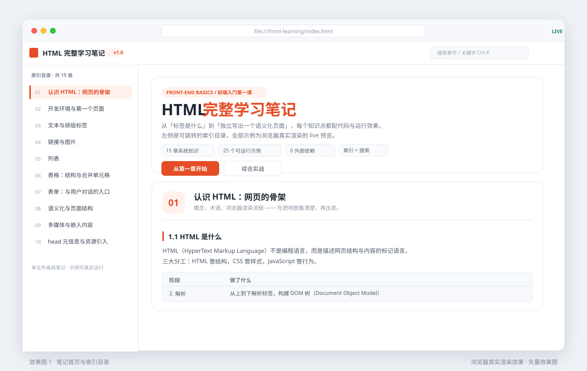
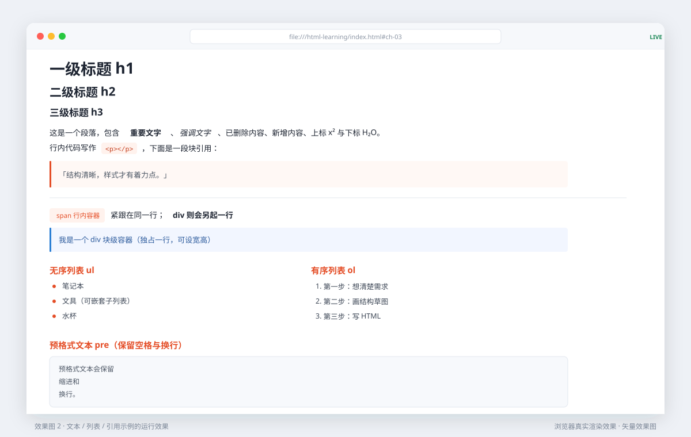
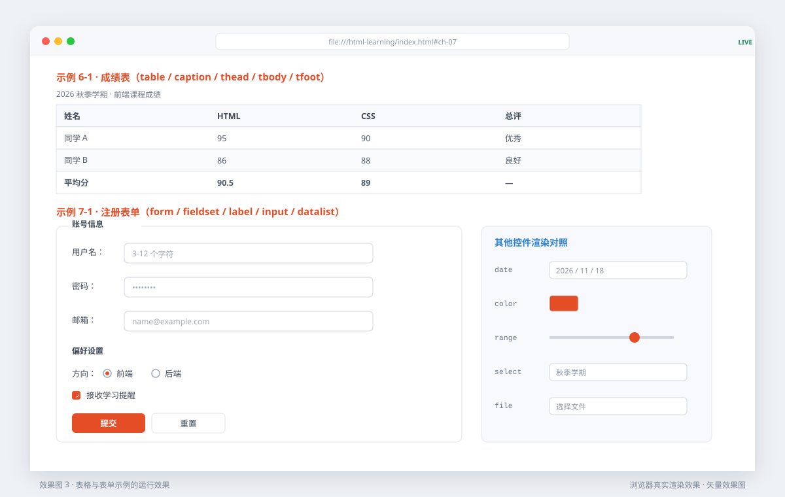
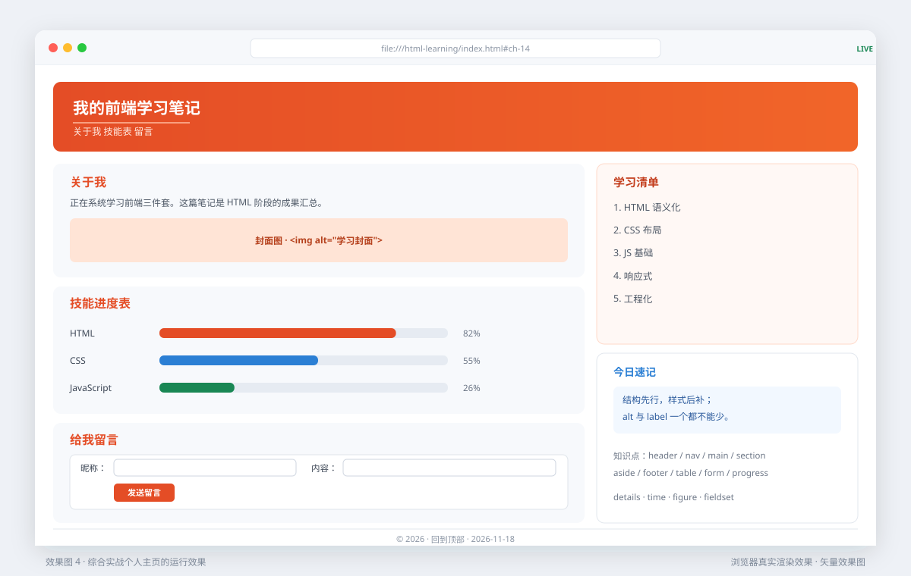

# HTML 完整学习笔记（完整阅读版）

> 适合**单次通读 / 全局搜索 / 打印**。分章阅读请打开 [docs/](docs/) 下对应章节；需要可交互的运行效果请打开 [HTML 交互版](index.html)。

## 目录

- [01 认识 HTML：网页的骨架](docs/ch01.md)
- [02 开发环境与第一个页面](docs/ch02.md)
- [03 文本与排版标签](docs/ch03.md)
- [04 链接与图片](docs/ch04.md)
- [05 列表：无序、有序与描述列表](docs/ch05.md)
- [06 表格：结构与合并单元格](docs/ch06.md)
- [07 表单：与用户对话的入口](docs/ch07.md)
- [08 语义化与页面结构](docs/ch08.md)
- [09 多媒体与嵌入内容](docs/ch09.md)
- [10 head 元信息与资源引入](docs/ch10.md)
- [11 全局属性、字符实体与编码](docs/ch11.md)
- [12 HTML5 新特性与相关 Web API](docs/ch12.md)
- [13 可访问性、编码规范与排错](docs/ch13.md)
- [14 综合实战：一个完整的个人主页](docs/ch14.md)
- [15 速查表、自测题与后续路线](docs/ch15.md)

**延伸资料**

- [16 知识补遗：内容模型、加载策略、ARIA、术语表](docs/ch16.md)
- [一页纸速查表](CHEATSHEET.md)
- [复习自测题合集（45 题）](REVIEW.md)
- [HTML 交互版（可运行示例）](index.html)

---

## 01 认识 HTML：网页的骨架

*概念、术语、浏览器渲染流程 —— 先把地图看清楚，再出发。*

[打开本章独立页面](docs/ch01.md) · [HTML 交互版](index.html#ch-01)

---

### 本章速览

本章要掌握：

- 1.1 HTML 是什么
- 1.2 浏览器拿到 HTML 之后做了什么
- 1.3 三个必须分清的术语

> 复习提示：先看章末「本节速记」与「本章复习自测」，再回看代码示例。

---

### 1.1 HTML 是什么

HTML（HyperText Markup Language，超文本标记语言）不是编程语言，而是**描述网页结构与内容的标记语言**。它用一对对标签把文字、图片、链接等包起来，告诉浏览器「这是一级标题」「那是一个按钮」。

- **超文本**：不只是文字，还能通过链接跳到另一个文档。
- **标记**：用 `<tag>` 这类标签给内容打上语义标记。
- **三大分工**：HTML 管结构，CSS 管样式，JavaScript 管行为。三者配合才有现代网页。

### 1.2 浏览器拿到 HTML 之后做了什么

| 阶段 | 做了什么 |
| --- | --- |
| 1. 请求 | 输入网址，浏览器向服务器发起 HTTP 请求，拿到 `.html` 文本 |
| 2. 解析 | 从上到下解析标签，构建 **DOM 树**（Document Object Model） |
| 3. 加载 | 遇到 `<link>` / `` / `<script>` 继续请求 CSS、图片、脚本 |
| 4. 渲染 | 结合 CSS 生成渲染树，计算布局，绘制到屏幕 |
| 5. 交互 | JavaScript 操作 DOM，响应用户点击、输入等事件 |

> **提示**：HTML 是**容错**的：写错标签浏览器也不会崩溃，会尽力猜测你的意图。但「能显示」不等于「写对了」——结构错误会影响 SEO、可访问性和后续维护。

### 1.3 三个必须分清的术语

| 术语 | 含义 | 例子 |
| --- | --- | --- |
| 标签 Tag | 尖括号包住的关键字，分开始标签与结束标签 | `<p>` 与 `</p>` |
| 元素 Element | 开始标签 + 内容 + 结束标签的整体 | `<p>你好</p>` |
| 属性 Attribute | 写在开始标签里，提供附加信息，形式 `名="值"` | `<a href="...">` 中的 `href` |

还有一类**空元素（void element）**没有内容和结束标签，例如 ``、`<br>`、`<input>`、`<meta>`、`<link>`、`<hr>`。HTML5 里写 `` 也可以，斜杠会被忽略。

**示例 1-1 · 标签、元素与属性的直观对照**

```html
<h3>一个最小的网页片段</h3>
<p>这是 <strong>段落元素</strong>，里面可以放 <em>强调文字</em> 和 <a href="#demo">链接属性</a>。</p>
<p>下面这个换行是空元素：<br>它后面另起一行。</p>
```

> 运行效果：打开 [HTML 交互版](index.html#ch-01) 可查看浏览器实时渲染（可点击、可输入）。

> **本节速记**：****HTML = 结构；标签 → 元素 → 属性；空元素无结束标签；浏览器解析 HTML 生成 DOM 树再渲染。

### 本章运行效果图



### 本章复习自测

<details>
<summary>HTML 是什么？它与 CSS、JavaScript 如何分工？</summary>

HTML 是描述网页结构与内容的标记语言；HTML 管结构、CSS 管表现、JavaScript 管行为。

</details>

<details>
<summary>标签、元素、属性三者有什么区别？</summary>

标签是尖括号关键字；元素是「开始标签 + 内容 + 结束标签」整体；属性是在开始标签里补充信息的 `名="值"`。

</details>

<details>
<summary>浏览器解析 HTML 后生成什么？举出 5 个空元素。</summary>

生成 DOM 树。空元素如 `img`、`br`、`hr`、`input`、`meta`、`link`、`source`。

</details>

[查看全部章节自测题](REVIEW.md)


---

## 02 开发环境与第一个页面

*DOCTYPE、html / head / body 骨架、注释、空白折叠与路径规则。*

[打开本章独立页面](docs/ch02.md) · [HTML 交互版](index.html#ch-02)

---

### 本章速览

本章要掌握：

- 2.1 最小可运行文档骨架
- 2.2 骨架逐行拆解
- 2.3 注释、空白折叠与路径

> 复习提示：先看章末「本节速记」与「本章复习自测」，再回看代码示例。

---

### 2.1 最小可运行文档骨架

一个规范的 HTML5 文档由 `<!DOCTYPE html>` 声明和 `<html>` 根元素组成，根元素内固定包含 `<head>`（元信息，不显示）与 `<body>`（可见内容）。

**示例 2-1 · 完整的 HTML5 文档骨架（笔记中展示 body 部分的运行效果）**

```html
<h1>我的第一个网页</h1>
<p>写在 body 里的内容才会出现在页面上。</p>
<p>head 里的 title 会显示在浏览器标签页上，而不是页面里。</p>
<hr>
<small>提示：把本示例「新窗口运行」打开，按 F12 可以看到完整的 DOM 结构。</small>
```

> 运行效果：打开 [HTML 交互版](index.html#ch-02) 可查看浏览器实时渲染（可点击、可输入）。

> **提示**：`<!DOCTYPE html>` 必须放在第一行：它告诉浏览器使用**标准模式**渲染，省略会触发怪异模式，导致 CSS 盒模型表现异常。`<meta charset="UTF-8">` 必须放在 head 最前面（前 1024 字节内），否则中文可能乱码。

### 2.2 骨架逐行拆解

| 写法 | 作用 |
| --- | --- |
| `<!DOCTYPE html>` | HTML5 文档声明，不是标签 |
| `<html lang="zh-CN">` | 根元素；`lang` 声明语言，利于屏幕阅读器与搜索引擎 |
| `<meta charset="UTF-8">` | 字符编码，中文必写 |
| `<meta name="viewport">` | 移动端视口设置，响应式页面必写 |
| `<title>` | 标签页标题，也是搜索结果标题 |
| `<body>` | 所有用户可见内容 |

配套工具：编辑器推荐 VS Code（装 Live Server 插件可热刷新）；浏览器按 `F12` 打开开发者工具，`Elements` 面板能看到实时 DOM。

### 2.3 注释、空白折叠与路径

注释写作 `<!-- 注释内容 -->`，不会显示在页面上，也不能嵌套。HTML 会把连续多个空格、换行、制表符**折叠成一个空格**；需要保留格式就用 `<pre>` 或 CSS 的 `white-space`。

| 路径写法 | 含义 | 示例 |
| --- | --- | --- |
| 同级相对路径 | 从当前文件所在目录找 | `src="logo.png"` |
| 下级相对路径 | 进入子目录 | `src="images/logo.png"` |
| 上级相对路径 | `../` 返回上一层 | `href="../index.html"` |
| 根相对路径 | 从站点根目录开始 | `src="/assets/logo.png"` |
| 绝对 URL | 完整协议 + 域名 | `https://example.com/a.png` |

**示例 2-2 · 空白折叠与 pre 的对比**

```html
<p>普通段落里   连续很多空格
和换行，最后   只会显示成一个空格。</p>
<pre>预格式文本会保留
    缩进和
        换行。</pre>
```

> **本节速记**：****DOCTYPE 第一行 → html → head + body；charset 与 viewport 必写；注释不嵌套；空白会被折叠；路径分相对与绝对。

### 本章复习自测

<details>
<summary>`<!DOCTYPE html>` 是标签吗？省略会怎样？</summary>

不是标签，是文档类型声明；省略会触发怪异模式，盒模型等渲染行为与标准不一致。

</details>

<details>
<summary>为什么 charset 要放在 head 最前面？</summary>

浏览器只在前 1024 字节内识别编码声明，位置靠后或缺失会导致中文乱码；文件也必须以 UTF-8 保存。

</details>

<details>
<summary>相对路径 `./`、`../`、`/` 各表示什么？viewport 有什么用？</summary>

同级目录 / 上一级目录 / 站点根目录。`viewport` 让移动端按设备宽度渲染，是响应式页面的前提。

</details>

[查看全部章节自测题](REVIEW.md)


---

## 03 文本与排版标签

*标题、段落、强调、引用、代码，以及块级与行内的区别。*

[打开本章独立页面](docs/ch03.md) · [HTML 交互版](index.html#ch-03)

---

### 本章速览

本章要掌握：

- 3.1 常用文本标签速览
- 3.2 块级元素 vs 行内元素

> 复习提示：先看章末「本节速记」与「本章复习自测」，再回看代码示例。

---

### 3.1 常用文本标签速览

| 标签 | 语义 | 类型 |
| --- | --- | --- |
| `<h1> ~ <h6>` | 一到六级标题，h1 一个页面建议只用一次 | 块级 |
| `<p>` | 段落，浏览器自动在上下留间距 | 块级 |
| `<br> <hr>` | 换行 / 主题分隔线（都是空元素） | — |
| `<strong> <em>` | **重要** / *强调*，带语义，优于 b / i | 行内 |
| `<del> <ins>` | 删除线 / 下划线（表示文档修订） | 行内 |
| `<sub> <sup>` | 下标 / 上标 | 行内 |
| `<blockquote>` | 块引用，可配 `cite` 属性 | 块级 |
| `<pre> <code>` | 预格式 / 行内代码 | 块级 / 行内 |
| `<div> <span>` | 无语义容器：块级 / 行内，用于布局与样式钩子 | 块级 / 行内 |

### 3.2 块级元素 vs 行内元素

**块级元素**独占一行、可设宽高与上下外边距（如 `div`、`p`、`h1`、`ul`）；**行内元素**跟在文字流里、宽高由内容决定（如 `span`、`a`、`strong`）。还有 `img`、`input` 这类**行内块**：不换行但可设宽高。

> **提示**：不要为了「变大加粗」就滥用 `<h1>`，也不要用 `<br><br>` 撑间距。视觉交给 CSS，语义交给 HTML。另外 `<p>` 里不能嵌 `<div>`，浏览器会自动把段落闭合。

**示例 3-1 · 文本标签全家福（真实渲染效果）**

```html
<h1>一级标题 h1</h1>
<h2>二级标题 h2</h2>
<h3>三级标题 h3</h3>
<p>这是一个段落，包含 <strong>重要文字</strong>、<em>强调文字</em>、
<del>已删除内容</del>、<ins>新增内容</ins>、上标 x<sup>2</sup> 与下标 H<sub>2</sub>O。</p>
<p>行内代码写作 <code>&lt;p&gt;&lt;/p&gt;</code>，下面是一段块引用：</p>
<blockquote cite="https://example.com">「结构清晰，样式才有着力点。」</blockquote>
<hr>
<p><span style="background:#fff2ed;color:#e44d26;padding:2px 6px;border-radius:4px">span 行内容器</span>
紧跟在同一行；<strong>div 则会另起一行</strong>。</p>
<div style="background:#f2f6ff;border-left:3px solid #2b7fd4;padding:8px 12px">我是一个 div 块级容器</div>
```

> 运行效果：打开 [HTML 交互版](index.html#ch-03) 可查看浏览器实时渲染（可点击、可输入）。

> **本节速记**：****标题有层级、段落成块；强调优先 strong / em；样式用 CSS，结构用语义标签；块级换行、行内随文。

### 本章运行效果图



### 本章复习自测

<details>
<summary>块级、行内、行内块元素有什么区别？各举两例。</summary>

块级独占一行可设宽高（div、p、h1、ul）；行内随文字流、宽高由内容决定（span、a、strong）；行内块不换行但可设宽高（img、input）。

</details>

<details>
<summary>`strong` 与 `b`、`em` 与 `i` 该优先用哪个？</summary>

优先 `strong` / `em`，它们带「重要 / 强调」语义，利于屏幕阅读器与 SEO；b / i 只描述外观。

</details>

<details>
<summary>为什么 `<p>` 里不能嵌 `<div>`？连续空格如何保留？</summary>

浏览器遇到块级元素会自动闭合段落，导致结构错乱。保留空白用 `<pre>` 或 CSS `white-space`，也可用 `&nbsp;`。

</details>

[查看全部章节自测题](REVIEW.md)


---

## 04 链接与图片

*a 的各类 href、锚点跳转、img 的 alt、figure 与响应式图片。*

[打开本章独立页面](docs/ch04.md) · [HTML 交互版](index.html#ch-04)

---

### 本章速览

本章要掌握：

- 4.1 超链接 a
- 4.2 图片 img 与 figure

> 复习提示：先看章末「本节速记」与「本章复习自测」，再回看代码示例。

---

### 4.1 超链接 a

| 写法 | 效果 |
| --- | --- |
| `href="page.html"` | 跳转到站内页面 |
| `href="https://..."` | 跳转外部站点 |
| `href="#ch-05"` | 跳到本页 `id="ch-05"` 的锚点 |
| `href="mailto:a@b.com"` | 唤起邮件客户端 |
| `href="tel:13800000000"` | 移动端拨号 |
| `href="a.pdf" download` | 下载而非打开 |
| `target="_blank"` | 新标签页打开，务必加 `rel="noopener"` |
| `title="说明"` | 鼠标悬停提示（不能替代 alt / 文字说明） |

> **提示**：使用 `target="_blank"` 时加上 `rel="noopener noreferrer"`，避免新页面通过 `window.opener` 反向操作原页面。

### 4.2 图片 img 与 figure

`` 是空元素。`alt` 是**必写**属性：图片加载失败时显示替代文字，也是屏幕阅读器与搜索引擎理解图片的唯一依据。装饰性图片可写 `alt=""`。显式声明 `width` / `height` 能避免加载时的布局抖动（CLS）。

需要「图 + 说明」时用 `<figure>` 包住 `` 和 `<figcaption>`；需要按屏幕密度/宽度换图时用 `<picture>` + `<source>` + `srcset`。

**示例 4-1 · 链接、锚点、图片占位与图注**

```html
<p><a href="#part2">跳到本示例的第二段（锚点）</a> ｜
<a href="mailto:hello@example.com">发邮件</a> ｜
<a href="https://developer.mozilla.org" target="_blank" rel="noopener">MDN（新标签页）</a></p>
<figure style="margin:14px 0;text-align:center">
  <div style="height:96px;line-height:96px;border-radius:10px;background:linear-gradient(120deg,#ffe4d6,#ffd0bb);color:#b5401c;font-weight:700">
    图片加载区 · &lt;img src="cover.png" alt="封面"&gt;
  </div>
  <figcaption style="color:#6c7686;font-size:13px;margin-top:6px">图 4-1：figure 与 figcaption 的组合效果</figcaption>
</figure>
<p id="part2">这里是锚点目标段落，点击上面的第一个链接会跳到这里。</p>
```

> 运行效果：打开 [HTML 交互版](index.html#ch-04) 可查看浏览器实时渲染（可点击、可输入）。

**示例 4-2 · picture / srcset 响应式图片写法**

```html
<p>按屏幕宽度切换图片资源：</p>
<pre>&lt;picture&gt;
  &lt;source media="(min-width: 800px)" srcset="cover-large.jpg"&gt;
  &lt;img src="cover-small.jpg" alt="课程封面" width="320"&gt;
&lt;/picture&gt;</pre>
<p>按像素密度切换：<code>srcset="pic.jpg 1x, pic@2x.jpg 2x"</code></p>
<div style="border:1px dashed #e44d26;border-radius:8px;padding:10px 14px;background:#fff8f5;font-size:13px">
  效果说明：宽屏加载 cover-large.jpg，窄屏加载 cover-small.jpg；<b>img 仍是必需的兜底</b>，alt 写在 img 上。
</div>
```

> **本节速记**：****href 支持页面 / 锚点 / 邮件 / 电话 / 下载；_blank 要配 noopener；img 必写 alt，配 figure 更语义化。

### 本章复习自测

<details>
<summary>`alt` 与 `title` 的区别是什么？</summary>

`alt` 是图片替代文本，加载失败时显示、供屏幕阅读器与搜索引擎使用，必写；`title` 只是悬停提示，不能替代 alt。

</details>

<details>
<summary>`target="_blank"` 为什么要加 `rel="noopener"`？</summary>

避免新页面通过 `window.opener` 反向操作原页面，属于安全与性能最佳实践。

</details>

<details>
<summary>`picture` / `srcset` 解决什么问题？为什么建议写 width / height？</summary>

按视口宽度或像素密度选择最合适的图片资源，节省流量；显式尺寸可避免图片加载时的布局抖动（CLS）。

</details>

[查看全部章节自测题](REVIEW.md)


---

## 05 列表：无序、有序与描述列表

*ul / ol / dl 的用法、常用属性与嵌套规则。*

[打开本章独立页面](docs/ch05.md) · [HTML 交互版](index.html#ch-05)

---

### 本章速览

本章要掌握：

- 5.1 三种列表

> 复习提示：先看章末「本节速记」与「本章复习自测」，再回看代码示例。

---

### 5.1 三种列表

| 标签 | 用途 | 常用属性 |
| --- | --- | --- |
| `<ul><li>` | 无序列表，项目无先后顺序 | CSS `list-style` |
| `<ol><li>` | 有序列表，有步骤/排名含义 | `start`、`type`、`reversed` |
| `<dl><dt><dd>` | 描述列表：术语 + 解释 | 一个 dt 可对应多个 dd |

`<li>` 里可以再嵌 `<ul>` / `<ol>` 形成多级列表，但**必须嵌在 li 内部**，不能直接放在 ul 下。列表项里也能放段落、链接、图片等任意内容。

**示例 5-1 · 三种列表与嵌套的真实效果**

```html
<h4>无序列表（购物清单）</h4>
<ul>
  <li>笔记本</li>
  <li>文具
    <ul><li>签字笔</li><li>便利贴</li></ul>
  </li>
  <li>水杯</li>
</ul>
<h4>有序列表（从 3 开始、倒序）</h4>
<ol start="3" reversed>
  <li>第三步：写 HTML</li>
  <li>第二步：画草图</li>
  <li>第一步：想清楚需求</li>
</ol>
<h4>描述列表（术语表）</h4>
<dl>
  <dt>HTML</dt><dd>超文本标记语言，负责结构</dd>
  <dt>CSS</dt><dd>层叠样式表，负责表现</dd>
</dl>
```

> 运行效果：打开 [HTML 交互版](index.html#ch-05) 可查看浏览器实时渲染（可点击、可输入）。

> **本节速记**：****ul 无顺序、ol 有顺序、dl 是术语解释；嵌套列表只能放进 li 里；ol 支持 start / reversed / type。

### 本章复习自测

<details>
<summary>`ul`、`ol`、`dl` 分别适用什么场景？</summary>

ul 无先后顺序的项目；ol 有步骤 / 排名含义；dl 是术语与解释的键值对。

</details>

<details>
<summary>`ol` 有哪些常用属性？</summary>

`start` 起始编号、`type` 编号样式（1 / A / a / I / i）、`reversed` 倒序；单项还可用 `value`。

</details>

<details>
<summary>嵌套列表的正确写法是什么？</summary>

子列表必须放进 `<li>` 内部，不能直接作为 `<ul>` / `<ol>` 的子元素。

</details>

[查看全部章节自测题](REVIEW.md)


---

## 06 表格：结构与合并单元格

*表格只用来展示「二维数据」，不要拿它做页面布局。*

[打开本章独立页面](docs/ch06.md) · [HTML 交互版](index.html#ch-06)

---

### 本章速览

本章要掌握：

- 6.1 表格的完整结构
- 6.2 colspan 与 rowspan

> 复习提示：先看章末「本节速记」与「本章复习自测」，再回看代码示例。

---

### 6.1 表格的完整结构

| 标签 | 作用 |
| --- | --- |
| `<table>` | 表格容器 |
| `<caption>` | 表格标题，写在 table 内第一个位置 |
| `<thead> / <tbody> / <tfoot>` | 表头 / 表体 / 表脚，语义分组，便于长表格分页打印 |
| `<tr>` | 表格行（table row） |
| `<th>` | 表头单元格，默认加粗居中；用 `scope="col\|row"` 指明方向 |
| `<td>` | 普通数据单元格 |
| `<colgroup> / <col>` | 按列统一设置样式 |

即使不写 `<tbody>`，浏览器也会自动补上。语义化分组让 CSS 选择器和屏幕阅读器更准确。

### 6.2 colspan 与 rowspan

`colspan="2"` 表示横向占两列，`rowspan="2"` 表示纵向占两行。合并后要**删掉被覆盖的单元格**，否则表格会错位。

**示例 6-1 · 带标题、表头与表脚的成绩表**

```html
<table>
  <caption>2026 秋季学期 · 前端课程成绩</caption>
  <thead><tr><th scope="col">姓名</th><th scope="col">HTML</th><th scope="col">CSS</th><th scope="col">总评</th></tr></thead>
  <tbody>
    <tr><th scope="row">同学 A</th><td>95</td><td>90</td><td>优秀</td></tr>
    <tr><th scope="row">同学 B</th><td>86</td><td>88</td><td>良好</td></tr>
  </tbody>
  <tfoot><tr><th scope="row">平均分</th><td>90.5</td><td>89</td><td>—</td></tr></tfoot>
</table>
```

> 运行效果：打开 [HTML 交互版](index.html#ch-06) 可查看浏览器实时渲染（可点击、可输入）。

**示例 6-2 · 合并单元格课程表**

```html
<table>
  <caption>课表（演示 colspan / rowspan）</caption>
  <tr><th>时间</th><th colspan="2">上午</th><th colspan="2">下午</th></tr>
  <tr><th rowspan="2">周一</th><td>HTML</td><td>CSS</td><td>JS</td><td>自习</td></tr>
  <tr><td>实验</td><td>实验</td><td>答疑</td><td>自习</td></tr>
</table>
```

> **提示**：表格的默认边框、间距由浏览器决定，实际项目用 CSS 的 `border-collapse`、`padding` 控制。移动端常用外层 `overflow-x:auto` 的容器包裹表格以横向滚动。

> **本节速记**：****caption → thead / tbody / tfoot → tr → th / td；表头加 scope；合并单元格后删除多余格子；表格不做布局。

### 本章复习自测

<details>
<summary>一个规范表格由哪些标签组成？</summary>

`table` > `caption` + `thead` / `tbody` / `tfoot` > `tr` > `th` / `td`，还有 `colgroup` / `col`。

</details>

<details>
<summary>`colspan` 与 `rowspan` 有什么区别？最容易犯什么错？</summary>

前者横向合并列、后者纵向合并行；合并后必须删除被覆盖的单元格，否则表格错位。

</details>

<details>
<summary>`th` 的 `scope` 有什么作用？为什么不用表格做布局？</summary>

`scope="col|row"` 指明表头方向，帮助屏幕阅读器关联单元格；表格语义是二维数据，用来布局会破坏可访问性与响应式。

</details>

[查看全部章节自测题](REVIEW.md)


---

## 07 表单：与用户对话的入口

*form、input 全类型、label、校验属性与提交原理。*

[打开本章独立页面](docs/ch07.md) · [HTML 交互版](index.html#ch-07)

---

### 本章速览

本章要掌握：

- 7.1 form 的工作方式
- 7.2 input 类型一览
- 7.3 其它控件与 label
- 7.4 HTML5 原生校验

> 复习提示：先看章末「本节速记」与「本章复习自测」，再回看代码示例。

---

### 7.1 form 的工作方式

用户填写控件 → 点击提交 → 浏览器把带 `name` 的控件按 `name=value` 打包 → 按 `method` 发送到 `action` 指定的地址。**没有 name 的控件不会被提交。**

| 属性 | 说明 |
| --- | --- |
| `action` | 接收数据的 URL，留空表示提交到当前页 |
| `method="get"` | 数据拼在 URL 查询串里，适合搜索、筛选（不适合密码） |
| `method="post"` | 数据放在请求体里，适合登录、写入操作 |
| `enctype` | 上传文件必须设为 `multipart/form-data` |
| `autocomplete / novalidate` | 自动填充 / 关闭原生校验 |

### 7.2 input 类型一览

| type | 用途 | type | 用途 |
| --- | --- | --- | --- |
| `text` | 单行文本（默认值） | `password` | 密码，输入被遮蔽 |
| `email / url / tel` | 带格式校验与移动端键盘优化 | `number` | 数字，配 min / max / step |
| `radio` | 单选，同组 name 必须相同 | `checkbox` | 多选，name 常用数组形式 |
| `date / time / datetime-local` | 原生日期时间选择器 | `month / week` | 月 / 周选择 |
| `range` | 滑块 | `color` | 取色器 |
| `file` | 文件上传，配 `multiple` / `accept` | `hidden` | 隐藏字段 |
| `search` | 搜索框 | `submit / reset / button` | 提交 / 重置 / 普通按钮 |

### 7.3 其它控件与 label

`<label>` 有两种关联写法：用 `for` 指向控件的 `id`，或直接把控件包在 label 里。关联后点击文字也能聚焦/勾选控件，对可访问性很关键。

- `<textarea rows cols>`：多行文本；`<select> + <option> + <optgroup>`：下拉选择
- `<fieldset> + <legend>`：给一组控件加分组标题
- `<datalist> + list`：给输入框提供候选建议（仍可自由输入）
- `<button type="submit|reset|button">`：比 input 按钮更灵活，可放图标

### 7.4 HTML5 原生校验

| 属性 | 作用 |
| --- | --- |
| `required` | 必填 |
| `placeholder` | 占位提示（不能替代 label） |
| `pattern` | 正则校验，如 `pattern="[0-9]{11}"` |
| `min / max / minlength / maxlength` | 数值或长度范围 |
| `checked / selected / disabled / readonly` | 布尔属性：写上即生效 |
| `autofocus / autocomplete` | 自动聚焦 / 自动填充策略 |

**示例 7-1 · 一个可直接交互的注册表单**

```html
<form action="#" method="post" onsubmit="alert('演示：这里不会真的提交');return false">
  <fieldset>
    <legend>账号信息</legend>
    <p><label for="u">用户名：</label>
       <input id="u" name="username" type="text" placeholder="3-12 个字符" required minlength="3" maxlength="12"></p>
    <p><label for="p">密码：</label>
       <input id="p" name="password" type="password" required minlength="6"></p>
    <p><label for="e">邮箱：</label>
       <input id="e" name="email" type="email" placeholder="name@example.com" required></p>
  </fieldset>
  <fieldset>
    <legend>偏好设置</legend>
    <p>方向：
      <label><input type="radio" name="track" value="fe" checked> 前端</label>
      <label><input type="radio" name="track" value="be"> 后端</label></p>
    <p><label><input type="checkbox" name="subscribe" checked> 接收学习提醒</label></p>
    <p><label for="lv">掌握程度：</label>
       <input id="lv" name="level" type="range" min="0" max="100" value="60"></p>
    <p><label for="city">常用编辑器：</label>
       <input id="city" name="editor" list="editors" placeholder="可输入或选择">
       <datalist id="editors"><option value="VS Code"><option value="WebStorm"><option value="Sublime Text"></datalist></p>
    <p><label for="bio">自我介绍：</label><br>
       <textarea id="bio" name="bio" rows="2" cols="34" placeholder="一句话介绍自己"></textarea></p>
  </fieldset>
  <button type="submit">提交</button> <button type="reset">重置</button>
</form>
```

> 运行效果：打开 [HTML 交互版](index.html#ch-07) 可查看浏览器实时渲染（可点击、可输入）。

**示例 7-2 · 各类 input 与 select 的渲染对照**

```html
<p>日期：<input type="date">　颜色：<input type="color" value="#e44d26">　数字：<input type="number" min="1" max="9" value="3" style="width:70px"></p>
<p>文件：<input type="file">　滑块：<input type="range" min="0" max="10" value="7"></p>
<p>下拉：
<select name="term">
  <optgroup label="2026 年"><option>春季学期</option><option selected>秋季学期</option></optgroup>
  <optgroup label="2027 年"><option>春季学期</option></optgroup>
</select></p>
<p>禁用：<input type="text" value="不可编辑" disabled>　只读：<input type="text" value="可复制不可改" readonly></p>
```

> **提示**：原生校验只是**用户体验层**，服务端必须重新校验所有数据。布尔属性写成 `required="false"` 依然是「必填」——只要属性存在就生效。

> **本节速记**：****name 决定提交什么，method 决定怎么发；label 必配；select / textarea / fieldset 各司其职；原生校验不能替代服务端校验。

### 本章运行效果图



### 本章复习自测

<details>
<summary>GET 与 POST 该怎么选？</summary>

GET 把数据拼在 URL 上，适合搜索 / 筛选等无副作用请求；POST 放请求体，适合登录、写入、上传。

</details>

<details>
<summary>某个输入框的值没被提交，最可能是什么原因？</summary>

控件缺少 `name`，或被 `disabled` 禁用；只有带 name 且启用的控件才会被序列化。

</details>

<details>
<summary>`label` 有哪两种关联方式？`disabled` 与 `readonly` 有何不同？</summary>

`for` 指向控件 id，或把控件直接包进 label；disabled 不聚焦、不提交，readonly 可聚焦、可复制、仍会提交。

</details>

[查看全部章节自测题](REVIEW.md)


---

## 08 语义化与页面结构

*HTML5 结构标签、SEO 与可访问性，写出「机器也读得懂」的页面。*

[打开本章独立页面](docs/ch08.md) · [HTML 交互版](index.html#ch-08)

---

### 本章速览

本章要掌握：

- 8.1 HTML5 结构标签地图
- 8.2 语义化的收益

> 复习提示：先看章末「本节速记」与「本章复习自测」，再回看代码示例。

---

### 8.1 HTML5 结构标签地图

| 标签 | 含义 |
| --- | --- |
| `<header>` | 页面或区块的头部（logo、标题、导航） |
| `<nav>` | 主导航链接集合 |
| `<main>` | 页面主内容，一个页面只能有一个 |
| `<article>` | 可独立分发的内容：文章、帖子、卡片 |
| `<section>` | 带主题的内容分组，通常有标题 |
| `<aside>` | 侧边栏、与主体相关的补充信息 |
| `<footer>` | 页脚：版权、联系方式、相关链接 |
| `<figure> / <figcaption>` | 独立的图、表、代码块及其说明 |
| `<time datetime="">` | 机器可读的时间 |
| `<mark> / <details> / <summary>` | 高亮 / 可折叠详情 |

### 8.2 语义化的收益

- **可访问性**：屏幕阅读器可以「跳到主内容」「列出所有导航」。
- **SEO**：搜索引擎更容易判断哪部分是正文、标题层级是否正确。
- **可维护性**：`<nav>` 一眼就懂，比 `<div class="nav">` 少一层心智负担。
- **健壮性**：样式丢失时页面仍保有清晰的结构与阅读顺序。

> **提示**：语义化不等于「把所有 div 换掉」：纯布局容器继续用 div；`<section>` 应当有标题，只是想加样式时用 div；标题层级要连续，别从 h1 直接跳到 h4。

**示例 8-1 · 语义化页面骨架（各区域已用颜色标注）**

```html
<header style="background:#ffe8de;border:1px solid #e44d26;border-radius:8px;padding:8px 12px;margin-bottom:8px">
  <b>&lt;header&gt;</b> 站点标题　
  <nav style="display:inline;color:#e44d26">&lt;nav&gt; 首页 ｜ 笔记 ｜ 关于</nav>
</header>
<div style="display:flex;gap:8px">
  <main style="flex:3;background:#eef5ff;border:1px solid #2b7fd4;border-radius:8px;padding:8px 12px">
    <b>&lt;main&gt;</b>
    <section style="background:#fff;border-radius:6px;padding:6px 10px;margin:6px 0">
      <b>&lt;section&gt;</b> 章节标题
      <article style="background:#f7f9fc;border-left:3px solid #2b7fd4;padding:6px 10px;margin-top:6px">
        <b>&lt;article&gt;</b> 一篇可独立分发的文章内容
      </article>
    </section>
  </main>
  <aside style="flex:1;background:#fff6d9;border:1px solid #d99b16;border-radius:8px;padding:8px 12px">
    <b>&lt;aside&gt;</b><br>侧边补充
  </aside>
</div>
<footer style="background:#eef0f4;border-radius:8px;padding:8px 12px;margin-top:8px;color:#555">
  <b>&lt;footer&gt;</b> 版权信息 · <time datetime="2026-11-18">2026 年 11 月 18 日</time>
</footer>
```

> 运行效果：打开 [HTML 交互版](index.html#ch-08) 可查看浏览器实时渲染（可点击、可输入）。

**示例 8-2 · details / summary 与 mark 的真实效果**

```html
<p>用 <mark>mark</mark> 高亮关键词，用 <code>time</code> 标记日期：<time datetime="2026-11-18">2026-11-18</time>。</p>
<details open>
  <summary>点击展开 / 收起：什么是 DOM？</summary>
  <p>DOM 是浏览器把 HTML 解析成的树状对象模型，JavaScript 通过它读写页面结构。</p>
</details>
<details>
  <summary>再看一个折叠项</summary>
  <p>这是第二项的内容，默认收起。</p>
</details>
```

> **本节速记**：****header / nav / main / article / section / aside / footer 各就各位；main 只能一个；语义化服务 a11y 与 SEO；纯布局仍用 div。

### 本章复习自测

<details>
<summary>语义化能带来哪些实际收益？</summary>

屏幕阅读器可跳转导航、搜索引擎更易理解正文、样式丢失仍可阅读、代码更易维护。

</details>

<details>
<summary>`section`、`article`、`div` 怎么选？`main` 能有几个？</summary>

可独立分发用 article，带主题分组用 section，纯布局用 div；一个页面只能有一个 main。

</details>

<details>
<summary>标题层级有什么规则？</summary>

从 h1 开始逐级递进，不跳级（h1 → h2 → h3），一个页面通常只有一个 h1。

</details>

[查看全部章节自测题](REVIEW.md)


---

## 09 多媒体与嵌入内容

*audio / video、内联 SVG、canvas、iframe 与响应式嵌入。*

[打开本章独立页面](docs/ch09.md) · [HTML 交互版](index.html#ch-09)

---

### 本章速览

本章要掌握：

- 9.1 音视频标签
- 9.2 SVG、Canvas 与 iframe

> 复习提示：先看章末「本节速记」与「本章复习自测」，再回看代码示例。

---

### 9.1 音视频标签

| 标签 / 属性 | 说明 |
| --- | --- |
| `<video src controls>` | 视频播放器；`poster` 封面、`width/height` 尺寸 |
| `<audio src controls>` | 音频播放器 |
| `<source src type>` | 提供多种格式，浏览器挑第一个能播的 |
| `<track kind="subtitles">` | 字幕文件（WebVTT），配 `srclang` / `label` |
| `autoplay / loop / muted / preload` | 自动播放 / 循环 / 静音 / 预加载策略 |

> **提示**：主流浏览器对自动播放有限制：带声音的 `autoplay` 通常被拦截，需同时加 `muted` 或由用户手势触发。

### 9.2 SVG、Canvas 与 iframe

- **内联 SVG**：矢量、可用 CSS 控制、可缩放不失真，适合图标与图表；直接写在 HTML 里。
- **canvas**：位图画布，靠 JavaScript 逐帧绘制，适合游戏与图像处理；标签本身只是占位。
- **iframe**：嵌入另一个页面。务必写 `title` 说明用途；用 `sandbox` 限制权限；用 `loading="lazy"` 延迟加载。
- **响应式嵌入**：外层容器设 `aspect-ratio` 或 `padding-top`，内部 iframe/video 设 `width:100%;height:100%`。

**示例 9-1 · 内联 SVG 图形（矢量、可无损缩放）**

```html
<p>下面这几块图形是 <strong>内联 SVG</strong>，不是图片文件：</p>
<svg width="100%" height="86" viewBox="0 0 420 86" style="background:#f7f9fc;border-radius:8px;border:1px solid #e2e7ee">
  <rect x="14" y="18" width="70" height="50" rx="8" fill="#e44d26"/>
  <circle cx="140" cy="43" r="26" fill="#f16529" opacity=".85"/>
  <polygon points="205,68 232,18 259,68" fill="#2b7fd4"/>
  <path d="M285 60 C305 10, 330 80, 360 26" stroke="#198754" stroke-width="4" fill="none"/>
  <text x="375" y="49" font-size="13" fill="#6c7686">SVG</text>
</svg>
```

> 运行效果：打开 [HTML 交互版](index.html#ch-09) 可查看浏览器实时渲染（可点击、可输入）。

**示例 9-2 · 视频 / 音频标签的播放器外观与占位说明**

```html
<p><b>&lt;video controls poster="cover.jpg" width="320"&gt;</b> 的占位效果：</p>
<div style="width:320px;max-width:100%;height:120px;border-radius:8px;background:linear-gradient(135deg,#2b3442,#4a5a70);color:#fff;display:flex;align-items:center;justify-content:center;font-size:13px">
  ▶ 视频封面 / poster
</div>
<p><b>&lt;audio controls src="bgm.mp3"&gt;</b> 的占位效果：</p>
<div style="width:320px;max-width:100%;border:1px solid #dfe4ea;border-radius:20px;padding:6px 12px;background:#f7f9fc;font-size:12px;color:#555">
  ▶ ────────────── 00:00 / 03:20
</div>
<p><small>真实项目里请换成 video / audio 标签并给出可用的媒体文件地址；此处用占位块是为了离线也能看到布局效果。</small></p>
```

> **本节速记**：****video / audio 配 source 提供多格式；SVG 矢量、canvas 位图；iframe 必写 title 并考虑 sandbox 与懒加载。

### 本章复习自测

<details>
<summary>`video` 有哪些常用属性？为什么自动播放经常失效？</summary>

src / controls / poster / width / height / autoplay / loop / muted / preload；浏览器会拦截带声音的自动播放，需加 muted 或由用户手势触发。

</details>

<details>
<summary>内联 SVG 与 canvas 有什么区别？</summary>

SVG 是矢量、可用 CSS 控制、缩放不失真，适合图标图表；canvas 是位图画布，靠 JS 逐帧绘制，适合游戏与图像处理。

</details>

<details>
<summary>使用 iframe 时要注意什么？</summary>

必写 `title` 说明用途；用 `sandbox` 限制权限；`loading="lazy"` 延迟加载；注意跨域与响应式尺寸。

</details>

[查看全部章节自测题](REVIEW.md)


---

## 10 head 元信息与资源引入

*页面「看不见但很重要」的部分：编码、视口、SEO、图标与脚本加载策略。*

[打开本章独立页面](docs/ch10.md) · [HTML 交互版](index.html#ch-10)

---

### 本章速览

本章要掌握：

- 10.1 head 里的常驻元素
- 10.2 defer 与 async 的区别
- 10.3 社交分享与 SEO 元信息

> 复习提示：先看章末「本节速记」与「本章复习自测」，再回看代码示例。

---

### 10.1 head 里的常驻元素

| 元素 | 作用 |
| --- | --- |
| `<title>` | 标签页标题、收藏夹名称、搜索结果标题 |
| `<meta charset="UTF-8">` | 字符编码，必须最靠前 |
| `<meta name="viewport">` | `width=device-width, initial-scale=1.0` |
| `<meta name="description">` | 搜索结果摘要，约 150 字以内 |
| `<link rel="stylesheet" href>` | 引入外部 CSS |
| `<link rel="icon" href>` | 站点图标 favicon |
| `<style> / <script>` | 内联样式 / 脚本 |
| `<base href target>` | 统一设置相对 URL 的基准（谨慎使用） |

#### 一份可直接复制的 head 模板

```html
<!-- head 内建议顺序（静态代码块，无需运行效果）-->
<meta charset="UTF-8">
<meta name="viewport" content="width=device-width, initial-scale=1.0">
<title>页面标题</title>
<meta name="description" content="一句话描述本页内容">
<link rel="icon" href="favicon.ico">
<link rel="stylesheet" href="style.css">
<script src="app.js" defer></script>
```

### 10.2 defer 与 async 的区别

| 写法 | 下载 | 执行时机 | 顺序 |
| --- | --- | --- | --- |
| 普通 `<script src>` | 阻塞 HTML 解析 | 下载完立即执行 | 按书写顺序 |
| `defer` | 并行下载 | HTML 解析完、DOMContentLoaded 前 | 保证顺序 |
| `async` | 并行下载 | 下载完立刻执行，可能打断解析 | 不保证顺序 |

页面脚本推荐 `defer`；第三方统计类、互不依赖的脚本适合 `async`。

### 10.3 社交分享与 SEO 元信息

Open Graph 协议让链接在微信、QQ、Twitter 等平台展示标题、摘要和封面，常用 `<meta property="og:title">`、`og:description`、`og:image`、`og:url`。此外 `<link rel="canonical">` 指定权威 URL，避免重复内容分散权重。

**示例 10-1 · head 元素速查清单（渲染效果）**

```html
<h3>head 里都放了什么？</h3>
<table>
  <tr><th>分类</th><th>关键元素</th></tr>
  <tr><td>基础</td><td>charset、viewport、title</td></tr>
  <tr><td>资源</td><td>link:stylesheet、link:icon、script defer</td></tr>
  <tr><td>SEO</td><td>description、robots、canonical</td></tr>
  <tr><td>分享</td><td>og:title、og:image、og:description</td></tr>
</table>
<p><small>提示：head 内的元素不会显示在页面主体中，本示例用表格把清单可视化。</small></p>
```

> 运行效果：打开 [HTML 交互版](index.html#ch-10) 可查看浏览器实时渲染（可点击、可输入）。

> **本节速记**：****charset 最前、viewport 必写；description 影响搜索摘要；脚本优先 defer；分享卡片靠 Open Graph。

### 本章复习自测

<details>
<summary>head 里通常放哪些元素？</summary>

charset、viewport、title、description、favicon（link:icon）、外部 CSS、script（建议 defer）、canonical、Open Graph。

</details>

<details>
<summary>defer 与 async 的执行时机和顺序有何不同？</summary>

两者都并行下载；defer 等 HTML 解析完按顺序执行，async 下载完立即执行、不保证顺序。页面脚本优先 defer。

</details>

<details>
<summary>Open Graph 与 canonical 分别解决什么问题？</summary>

OG 让链接在社交平台显示标题 / 摘要 / 封面；canonical 指定权威 URL，避免重复内容分散搜索权重。

</details>

[查看全部章节自测题](REVIEW.md)


---

## 11 全局属性、字符实体与编码

*所有标签都能用的属性、特殊字符怎么显示，以及乱码的根源。*

[打开本章独立页面](docs/ch11.md) · [HTML 交互版](index.html#ch-11)

---

### 本章速览

本章要掌握：

- 11.1 全局属性
- 11.2 字符实体

> 复习提示：先看章末「本节速记」与「本章复习自测」，再回看代码示例。

---

### 11.1 全局属性

| 属性 | 作用 |
| --- | --- |
| `id` | 文档内唯一标识，用于锚点、CSS、JS 定位 |
| `class` | 可复用的类名，多个值用空格分隔 |
| `style` | 行内样式（优先级高，尽量少用） |
| `title` | 悬停提示文本 |
| `lang / dir` | 语言 / 文字方向（ltr、rtl） |
| `data-*` | 自定义数据属性，JS 通过 `dataset` 读取 |
| `hidden` | 布尔属性，隐藏元素（等于 display:none） |
| `tabindex` | 键盘 Tab 顺序；0 可聚焦、-1 仅脚本聚焦，正数不推荐 |
| `contenteditable` | 让元素内容可编辑 |
| `draggable / spellcheck / translate` | 拖拽 / 拼写检查 / 是否参与翻译 |
| `aria-*` / `role` | 为辅助技术补充语义（WAI-ARIA） |

### 11.2 字符实体

HTML 中 `<`、`>`、`&` 有特殊含义，要显示它们本身必须写**字符实体**：`&lt;`、`&gt;`、`&amp;`。实体可以用名称或数字（十进制 `&#169;` / 十六进制 `&#xA9;`）。

| 显示 | 实体 | 说明 |
| --- | --- | --- |
| 空格 | `&nbsp;` | 不换行空格，可用来阻止空白折叠 |
| &lt; &gt; | `&lt; &gt;` | 小于号 / 大于号 |
| & | `&amp;` | 和号 |
| " ' | `&quot; &#39;` | 双引号 / 单引号 |
| © ® ™ | `&copy; &reg; &trade;` | 版权 / 注册 / 商标 |

**示例 11-1 · 字符实体的渲染对照**

```html
<p>标签原文： &lt;h1&gt;标题&lt;/h1&gt;</p>
<p>特殊符号： &amp;　&quot;　&copy;　&reg;　&trade;　&times;　&divide;</p>
<p>不换行空格：A&nbsp;&nbsp;&nbsp;B（中间的三个空格不会被折叠）</p>
<p>十六进制实体：&#x2764; &#x1F680;（爱心与火箭）</p>
```

> 运行效果：打开 [HTML 交互版](index.html#ch-11) 可查看浏览器实时渲染（可点击、可输入）。

**示例 11-2 · 全局属性的可见效果**

```html
<p title="我是 title 属性的悬停提示">把鼠标停在这行文字上，会看到 title 提示。</p>
<p><span hidden>这行写了 hidden，你看不见我。</span>上一句被隐藏了。</p>
<p contenteditable="true" style="border:1px dashed #e44d26;border-radius:6px;padding:8px 12px;background:#fff8f5">
  这个段落有 contenteditable="true"，点一下就能直接编辑文字。</p>
<p><span data-chapter="11" data-role="demo" style="background:#eef5ff;padding:3px 8px;border-radius:5px">
  我带着 data-* 自定义数据，供 JavaScript 读取</span></p>
<p><a href="#ch-12" tabindex="0">带 tabindex 的链接</a>（Tab 键可聚焦）</p>
```

> **提示**：中文变「锟斤拷」或问号，几乎都是**文件保存编码**与 `<meta charset>` 声明不一致。统一用 UTF-8 保存文件，并把 charset 放在 head 最前面即可。

> **本节速记**：****id 唯一、class 可复用；data-* 存自定义数据；特殊字符用实体；编码统一 UTF-8。

### 本章复习自测

<details>
<summary>id 与 class 有什么区别？</summary>

id 文档内唯一，用于锚点 / JS 精确定位；class 可复用、可多值，主要用于样式选择器。

</details>

<details>
<summary>`data-*` 有什么用？JavaScript 怎么读？</summary>

存自定义数据而不污染 class；通过元素的 `dataset` 读取，如 `el.dataset.chapter`。

</details>

<details>
<summary>为什么要写字符实体？中文乱码怎么排查？</summary>

`<`、`>`、`&` 在 HTML 中有特殊含义，显示本身须写 `&lt;` / `&gt;` / `&amp;`；乱码查文件编码与 charset 是否一致。

</details>

[查看全部章节自测题](REVIEW.md)


---

## 12 HTML5 新特性与相关 Web API

*新标签、新控件、原生弹窗，以及 HTML 常一起使用的浏览器能力。*

[打开本章独立页面](docs/ch12.md) · [HTML 交互版](index.html#ch-12)

---

### 本章速览

本章要掌握：

- 12.1 HTML5 带来了什么
- 12.2 原生进度、度量与弹窗
- 12.3 常与 HTML 一起用的 Web API

> 复习提示：先看章末「本节速记」与「本章复习自测」，再回看代码示例。

---

### 12.1 HTML5 带来了什么

| 类别 | 新增内容 |
| --- | --- |
| 语义标签 | header / nav / main / article / section / aside / footer / figure / time / mark |
| 表单增强 | email / url / date / range / color / number、required / pattern / placeholder、datalist |
| 多媒体 | audio / video / track / source、canvas、内联 SVG |
| 新元素 | details / summary、dialog、progress / meter / output、template、picture |
| JS API | Web Storage、拖放、地理定位、History、Web Workers、Custom Elements |

### 12.2 原生进度、度量与弹窗

- `<progress value="60" max="100">`：任务完成进度。
- `<meter value="7" min="0" max="10">`：已知范围内的度量值（如评分、磁盘用量）。
- `<output>`：表示计算或用户操作的结果。
- `<dialog>`：原生模态框，用 JS 的 `showModal()` / `close()` 控制。
- `<template>`： inert 模板片段，内容不会被渲染，供 JS 克隆复用。
- `<picture> + srcset / sizes`：按视口或像素密度选择最合适的图片（响应式图片）。

**示例 12-1 · progress / meter / output 的真实渲染**

```html
<p>课程完成度：<progress value="62" max="100"></progress> 62%</p>
<p>磁盘使用：<meter value="7" min="0" max="10" low="3" high="8" optimum="2"></meter> 7 / 10</p>
<p>计算结果：<output name="result">42</output>（output 表示结果输出）</p>
<p>响应式图片写法提示：<code>&lt;picture&gt;&lt;source media="(min-width:800px)" srcset="big.jpg"&gt;&lt;img src="small.jpg" alt="..."&gt;&lt;/picture&gt;</code></p>
```

> 运行效果：打开 [HTML 交互版](index.html#ch-12) 可查看浏览器实时渲染（可点击、可输入）。

**示例 12-2 · 原生 dialog 弹窗（可点击体验）**

```html
<button onclick="document.getElementById('myDlg').showModal()">打开原生对话框</button>
<dialog id="myDlg" style="border:1px solid #dfe4ea;border-radius:10px;padding:18px 22px;box-shadow:0 8px 30px rgba(0,0,0,.18)">
  <p><b>这是一个 &lt;dialog&gt; 元素</b></p>
  <p>由浏览器原生提供模态能力，无需额外 UI 库。</p>
  <button onclick="document.getElementById('myDlg').close()">关闭</button>
</dialog>
<p><small>点击按钮试试；showModal() 会自动带遮罩并支持 Esc 关闭。</small></p>
```

### 12.3 常与 HTML 一起用的 Web API

**示例 12-3 · HTML5 相关 API 速览**

```html
<table>
  <tr><th>API</th><th>典型用途</th><th>一句话说明</th></tr>
  <tr><td>localStorage</td><td>记住主题、草稿</td><td>持久化键值存储，约 5MB</td></tr>
  <tr><td>sessionStorage</td><td>单次会话状态</td><td>关闭标签页即清除</td></tr>
  <tr><td>Drag &amp; Drop</td><td>拖拽排序、上传</td><td>draggable 属性 + drag 事件</td></tr>
  <tr><td>Geolocation</td><td>定位、附近服务</td><td>需用户授权且通常要求 HTTPS</td></tr>
  <tr><td>History API</td><td>单页应用路由</td><td>pushState 改 URL 不刷新</td></tr>
  <tr><td>Custom Elements</td><td>自定义组件</td><td>Web Components 的核心</td></tr>
</table>
<p><small>这些能力由 JavaScript 调用，HTML 负责提供结构与触发入口。</small></p>
```

> **本节速记**：****progress 表进度、meter 表度量；dialog 提供原生模态；template 存模板；picture 做响应式图片；Storage / History 等交给 JS。

### 本章复习自测

<details>
<summary>`progress` 与 `meter` 有什么区别？</summary>

progress 表示任务完成进度（value / max）；meter 表示已知范围内的度量值（min / max / low / high / optimum）。

</details>

<details>
<summary>原生 `dialog` 怎么打开和关闭？`template` 有什么特点？</summary>

用 JS 的 `showModal()` / `close()`；template 内容不会被渲染，是惰性的，供 JS 克隆复用。

</details>

<details>
<summary>localStorage 与 sessionStorage 的区别？</summary>

localStorage 持久化保存（约 5MB），sessionStorage 仅在当前标签页会话有效，关闭即清除。

</details>

[查看全部章节自测题](REVIEW.md)


---

## 13 可访问性、编码规范与排错

*让页面对所有人可用，也让自己半年后还读得懂。*

[打开本章独立页面](docs/ch13.md) · [HTML 交互版](index.html#ch-13)

---

### 本章速览

本章要掌握：

- 13.1 可访问性（a11y）清单
- 13.2 编码规范
- 13.3 常见错误与排错工具

> 复习提示：先看章末「本节速记」与「本章复习自测」，再回看代码示例。

---

### 13.1 可访问性（a11y）清单

- 每张有意义的图片都写清 `alt`，纯装饰图写 `alt=""`。
- 每个表单控件都有关联的 `<label>`；错误提示用文字而非仅靠颜色。
- 用语义标签表达结构，保持标题层级连续；导航区包 `<nav>`。
- 保证键盘可达：链接/按钮天然可 Tab，自定义控件才补 `tabindex` 与键盘事件。
- 文字与背景有足够对比度；不要只用颜色传达状态。
- 需要时用 `role` 与 `aria-label` / `aria-describedby` 补充语义，但**优先使用原生标签**。
- 给 iframe 写 `title`，给 video 配 `<track>` 字幕。

### 13.2 编码规范

| 建议 | 反例 → 正例 |
| --- | --- |
| 标签名、属性名小写 | `<DIV CLASS="A">` → `<div class="a">` |
| 属性值统一双引号 | `href=a.html` → `href="a.html"` |
| 成对标签必须闭合 | `<p>文字` → `<p>文字</p>` |
| 缩进 2 空格，嵌套有层次 | 同级元素随意换行 |
| id / class 见名知意 | `a1` → `user-card` |
| 结构、样式、脚本分离 | 满屏 `style=""` → 外部 CSS |

**示例 13-1 · 「不推荐」与「推荐」写法对照**

```html
<div style="display:flex;gap:12px;flex-wrap:wrap">
  <div style="flex:1;min-width:220px;border:1px solid #f0b6b6;background:#fff5f5;border-radius:8px;padding:10px 14px">
    <b style="color:#c33d3d">不推荐</b>
    <p><code>&lt;div class="btn" onclick="go()"&gt;提交&lt;/div&gt;</code></p>
    <p><code>&lt;img src="a.png"&gt;</code></p>
    <p><small>无语义、无 alt、键盘不可达、样式语义混在一起。</small></p>
  </div>
  <div style="flex:1;min-width:220px;border:1px solid #a9d8bb;background:#f3fbf6;border-radius:8px;padding:10px 14px">
    <b style="color:#198754">推荐</b>
    <p><code>&lt;button type="submit"&gt;提交&lt;/button&gt;</code></p>
    <p><code>&lt;img src="a.png" alt="课程封面" width="320"&gt;</code></p>
    <p><small>语义明确、可聚焦、可访问、样式交给 CSS。</small></p>
  </div>
</div>
```

> 运行效果：打开 [HTML 交互版](index.html#ch-13) 可查看浏览器实时渲染（可点击、可输入）。

### 13.3 常见错误与排错工具

| 症状 | 常见原因 |
| --- | --- |
| 中文乱码 | 文件编码与 charset 不一致 |
| 图片裂开 | src 路径写错、大小写不匹配（服务器区分大小写） |
| 样式不生效 | link 路径错、选择器权重不够、被行内样式覆盖 |
| 表单没提交数据 | 控件缺少 `name` 或被 `disabled` |
| 布局突然错位 | 标签没闭合、p 里嵌 div、表格 colspan 算错 |
| 移动端字很小 | 缺少 viewport meta |

排错三板斧：**F12 开发者工具**看 Elements 与 Console、**W3C Markup Validator** 校验标签、**Lighthouse / axe** 检查可访问性与 SEO。

**示例 13-2 · 上线前的自检清单**

```html
<h4>发布前 8 项检查</h4>
<ol>
  <li>DOCTYPE、lang、charset、viewport 齐全</li>
  <li>title 与 description 已填写</li>
  <li>所有 img 都有 alt，所有 iframe 都有 title</li>
  <li>所有表单控件都有 label 与 name</li>
  <li>标题层级连续，只有一个 main</li>
  <li>链接无空 href，外链加 rel="noopener"</li>
  <li>通过 W3C 校验，无未闭合标签</li>
  <li>用键盘 Tab 走一遍，焦点顺序正常</li>
</ol>
```

> **本节速记**：****alt / label / 语义 / 键盘可达是 a11y 四件套；命名与缩进统一；乱码查编码、裂图查路径、不提交查 name。

### 本章复习自测

<details>
<summary>可访问性最基础的四件事是什么？</summary>

图片写 alt、控件关联 label、使用语义标签与连续标题层级、保证键盘可聚焦与焦点顺序。

</details>

<details>
<summary>ARIA 的使用原则是什么？</summary>

优先使用原生语义标签；只有原生元素无法表达时才补 `role` / `aria-*`，且不要与原生语义冲突。

</details>

<details>
<summary>页面出问题时常用哪些工具排查？</summary>

F12 开发者工具（Elements / Console）、W3C Markup Validator 校验标签、Lighthouse / axe 审计可访问性与 SEO。

</details>

[查看全部章节自测题](REVIEW.md)


---

## 14 综合实战：一个完整的个人主页

*把前 13 章的知识串起来：语义结构、列表、表格、表单、figure、锚点一次用齐。*

[打开本章独立页面](docs/ch14.md) · [HTML 交互版](index.html#ch-14)

---

### 本章速览

本章要掌握：

- 14.1 先规划结构，再写代码
- 14.2 完整示例（下方是真实运行效果）
- 14.3 这个页面用到了哪些知识点

> 复习提示：先看章末「本节速记」与「本章复习自测」，再回看代码示例。

---

### 14.1 先规划结构，再写代码

动手前先画草图：`header`（站点名 + `nav` 锚点导航）→ `main` 里三个 `section`（关于我 / 技能表格 / 留言表单）→ 侧边 `aside`（学习清单）→ `footer`。结构清楚了，HTML 基本就是「照着填」。

### 14.2 完整示例（下方是真实运行效果）

**示例 14-1 · 综合实战：个人主页（可直接点击交互）**

```html
<header style="background:linear-gradient(120deg,#e44d26,#f16529);color:#fff;border-radius:10px;padding:16px 20px">
  <h1 style="margin:0;font-size:22px">我的前端学习笔记</h1>
  <nav style="margin-top:8px;font-size:13px">
    <a href="#about" style="color:#fff;margin-right:14px">关于我</a>
    <a href="#skill" style="color:#fff;margin-right:14px">技能表</a>
    <a href="#msg" style="color:#fff">留言</a>
  </nav>
</header>
<div style="display:flex;gap:14px;margin-top:12px;flex-wrap:wrap">
  <main style="flex:3;min-width:260px">
    <section id="about" style="background:#f7f9fc;border-radius:10px;padding:14px 18px;margin-bottom:12px">
      <h2 style="margin:0 0 8px;font-size:18px;color:#e44d26">关于我</h2>
      <p style="margin:4px 0">正在系统学习前端三件套。这篇笔记是 HTML 阶段的成果汇总。</p>
      <figure style="margin:10px 0 0;text-align:center">
        <div style="height:70px;line-height:70px;background:linear-gradient(120deg,#ffe4d6,#ffd0bb);border-radius:8px;color:#b5401c;font-weight:700">封面图 · &lt;img alt="学习封面"&gt;</div>
        <figcaption style="font-size:12px;color:#6c7686">图 14-1：figure + figcaption</figcaption>
      </figure>
    </section>
    <section id="skill" style="background:#f7f9fc;border-radius:10px;padding:14px 18px;margin-bottom:12px">
      <h2 style="margin:0 0 8px;font-size:18px;color:#e44d26">技能进度表</h2>
      <table>
        <caption style="font-size:12px;color:#6c7686">2026 秋季学期自评</caption>
        <tr><th>技能</th><th>掌握度</th><th>状态</th></tr>
        <tr><td>HTML</td><td><progress value="80" max="100"></progress></td><td>熟练</td></tr>
        <tr><td>CSS</td><td><progress value="55" max="100"></progress></td><td>学习中</td></tr>
        <tr><td>JavaScript</td><td><progress value="25" max="100"></progress></td><td>入门</td></tr>
      </table>
    </section>
    <section id="msg" style="background:#f7f9fc;border-radius:10px;padding:14px 18px">
      <h2 style="margin:0 0 8px;font-size:18px;color:#e44d26">给我留言</h2>
      <form action="#" method="post" onsubmit="alert('演示表单：不会真的提交');return false">
        <fieldset style="border:1px solid #dfe4ea;border-radius:8px">
          <legend style="font-size:13px">留言信息</legend>
          <p><label for="n">昵称：</label><input id="n" name="nick" required placeholder="怎么称呼你"></p>
          <p><label for="m">内容：</label><br><textarea id="m" name="msg" rows="2" cols="30" required></textarea></p>
          <p><label><input type="checkbox" name="agree" checked> 同意展示在页面上</label></p>
          <button type="submit">发送留言</button>
        </fieldset>
      </form>
    </section>
  </main>
  <aside style="flex:1;min-width:180px;background:#fff8f5;border:1px solid #ffd9c9;border-radius:10px;padding:14px 18px;align-self:flex-start">
    <h3 style="margin:0 0 8px;font-size:15px;color:#c33d1c">学习清单</h3>
    <ol style="padding-left:18px;margin:0"><li>HTML 语义化</li><li>CSS 布局</li><li>JS 基础</li><li>响应式</li><li>工程化</li></ol>
    <details style="margin-top:10px"><summary style="font-size:13px">今日速记</summary>
      <p style="font-size:12px;color:#555">结构先行，样式后补；alt 与 label 一个都不能少。</p></details>
  </aside>
</div>
<footer style="text-align:center;color:#6c7686;font-size:12px;margin-top:14px;padding:10px;border-top:1px solid #e2e7ee">
  © 2026 · <a href="#top">回到顶部</a> · <time datetime="2026-11-18">2026-11-18</time>
</footer>
```

> 运行效果：打开 [HTML 交互版](index.html#ch-14) 可查看浏览器实时渲染（可点击、可输入）。

> **提示**：仓库中的 `examples/complete-page.html` 是这份示例的**完整文档版本**（含 DOCTYPE、head、body），可以直接双击在浏览器打开或作为新项目的起点。

### 14.3 这个页面用到了哪些知识点

| 章节 | 在实战中的落点 |
| --- | --- |
| 02 文档骨架 | 完整的 head + body 组织（见配套文件） |
| 04 链接与图片 | nav 锚点导航、figure / figcaption、外链 |
| 05 / 06 列表表格 | aside 有序清单、技能进度表格 |
| 07 表单 | label、fieldset / legend、required、textarea、checkbox |
| 08 语义化 | header / nav / main / section / aside / footer / time |
| 12 HTML5 | progress、details / summary |
| 13 可访问性 | label 关联、表单 name、语义层级、alt |

> **本节速记**：****先画结构草图 → 用语义标签搭骨架 → 逐个区块填内容 → 最后用 CSS 美化；HTML 阶段不追求好看，追求「结构正确」。

### 本章运行效果图



### 本章复习自测

<details>
<summary>动手写页面前应该先做什么？</summary>

先画结构草图，确定 header / nav / main / section / aside / footer 的分区，再用语义标签搭骨架，最后填内容与补样式。

</details>

<details>
<summary>综合示例里用到了哪些表单与 HTML5 元素？</summary>

form / fieldset / legend / label / input / textarea / checkbox / required，以及 progress、details / summary、time、figure。

</details>

<details>
<summary>HTML 阶段最应该追求什么？</summary>

结构正确、语义清晰、可访问，而不是视觉好看；视觉交给 CSS，行为交给 JavaScript。

</details>

[查看全部章节自测题](REVIEW.md)


---

## 15 速查表、自测题与后续路线

*一页查完常用标签，再用 12 道题确认自己真的学会了。*

[打开本章独立页面](docs/ch15.md) · [HTML 交互版](index.html#ch-15)

---

### 本章速览

本章要掌握：

- 15.1 常用标签速查
- 15.2 高频属性速查
- 15.3 自测题（点击展开答案）
- 15.4 接下来学什么

> 复习提示：先看章末「本节速记」与「本章复习自测」，再回看代码示例。

---

### 15.1 常用标签速查

#### 文档与结构

- `<!DOCTYPE> html head body`
- `meta link style script title base`
- `header nav main article section aside footer`

#### 文本与内容

- `h1~h6 p br hr div span`
- `strong em b i del ins sub sup mark small`
- `blockquote q pre code time figure figcaption`

#### 列表、表格、媒体

- `ul ol li dl dt dd`
- `table caption thead tbody tfoot tr th td colgroup`
- `img picture source audio video track iframe svg canvas`

#### 表单与交互

- `form input label button textarea select option optgroup`
- `fieldset legend datalist output progress meter`
- `details summary dialog template`

### 15.2 高频属性速查

| 属性 | 适用 | 属性 | 适用 |
| --- | --- | --- | --- |
| `id / class / style / title` | 全局 | `data-* / hidden / tabindex` | 全局 |
| `href / target / rel / download` | a、link | `src / alt / width / height / loading` | img、iframe |
| `name / value / type / placeholder` | 表单控件 | `required / pattern / min / max / checked` | 表单控件 |
| `colspan / rowspan / scope` | 表格单元格 | `charset / content / property` | meta |
| `defer / async` | script | `controls / autoplay / loop / poster` | video、audio |

**示例 15-1 · 速查卡片的渲染效果**

```html
<div style="display:flex;gap:10px;flex-wrap:wrap">
  <div style="flex:1;min-width:150px;border:1px solid #e2e7ee;border-radius:8px;padding:10px 14px;background:#fff8f5">
    <b style="color:#e44d26">结构</b><p style="margin:4px 0"><code>div span header main</code></p></div>
  <div style="flex:1;min-width:150px;border:1px solid #e2e7ee;border-radius:8px;padding:10px 14px;background:#f2f8ff">
    <b style="color:#2b7fd4">内容</b><p style="margin:4px 0"><code>h1 p a img table</code></p></div>
  <div style="flex:1;min-width:150px;border:1px solid #e2e7ee;border-radius:8px;padding:10px 14px;background:#f3fbf6">
    <b style="color:#198754">交互</b><p style="margin:4px 0"><code>form input button</code></p></div>
</div>
```

> 运行效果：打开 [HTML 交互版](index.html#ch-15) 可查看浏览器实时渲染（可点击、可输入）。

### 15.3 自测题（点击展开答案）

### 15.4 接下来学什么

| 阶段 | 目标 |
| --- | --- |
| CSS 基础 | 选择器、盒模型、Flex / Grid 布局、响应式与媒体查询 |
| JavaScript 基础 | 变量、函数、DOM 操作、事件、异步与 fetch |
| 工程化 | Git、包管理、构建工具、框架（Vue / React） |
| 进阶 | 可访问性审计、性能优化、SEO、Web Components |

> **本节速记**：****先用速查表回忆，再用自测题查漏；HTML 打底之后，下一步是 CSS 布局与 JavaScript 交互。

### 本章复习自测

<details>
<summary>速查表是按什么维度组织标签的？</summary>

按用途分为文档与结构、文本与内容、列表表格媒体、表单与交互四组，便于按场景反查。

</details>

<details>
<summary>学完 HTML 之后的合理路线是什么？</summary>

CSS（盒模型、Flex / Grid、响应式）→ JavaScript（DOM、事件、异步）→ Git 与工程化 → 框架 → 性能与可访问性进阶。

</details>

<details>
<summary>怎样检验自己真的掌握了 HTML？</summary>

能不看资料写出规范骨架、能解释每个标签的语义、能通过 W3C 校验、能用键盘走通页面、能完成自测题。

</details>

[查看全部章节自测题](REVIEW.md)


---
