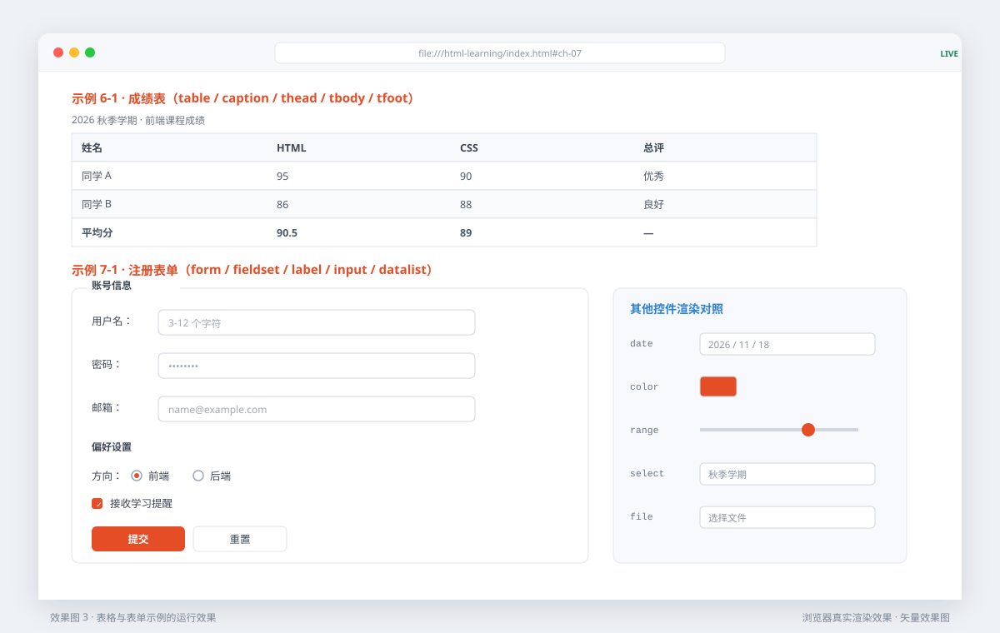
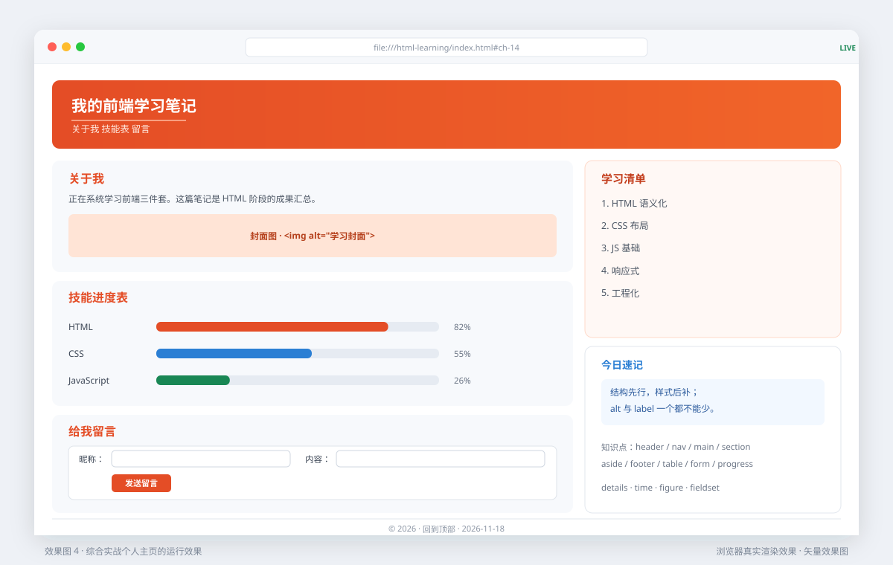

# HTML 完整学习笔记

> 学习 HTML 的笔记与示例。一份**带索引目录**的系统笔记，每个知识点都配有代码片段和**浏览器运行后的效果图**。

**15 章系统知识** · **39 个索引小节** · **25 个可运行示例** · **0 外部依赖** · 浅色 / 深色双主题

---

## 怎么打开这份笔记

**最简单**：克隆或下载本仓库后，双击 [`index.html`](index.html) —— 单文件、零依赖、离线可用，用任意现代浏览器打开即可。

打开后你会得到：

- 左侧**可跳转的索引目录**（15 章 + 39 个小节），支持关键字搜索、分组折叠、滚动自动高亮
- 每个示例上方是**语法高亮的代码**，下方是**带浏览器标题栏的真实运行效果预览**（`iframe srcdoc` 实时渲染，不是截图，可点击、可输入）
- 每个示例都能「复制代码」或「新窗口运行」，右上角可切换浅色 / 深色主题

> 若想在线访问：在仓库 **Settings → Pages** 中选择 `main` 分支根目录并保存，稍后即可通过 `https://hey-yancy.github.io/html-learning/` 打开。

---

## 运行效果图

以下效果图随仓库一起提供（纯矢量 SVG，Github 可直接显示）；笔记内部还有 25 个可交互的 live 预览。

### 效果图 1 · 笔记首页与索引目录

### 效果图 2 · 文本、列表与引用示例

### 效果图 3 · 表格与表单示例

### 效果图 4 · 综合实战个人主页

---

## 完整索引目录

> 点击标题可跳转到本地 `index.html` 的对应章节（在浏览器中打开笔记时生效）。

### 基础篇

- [01 认识 HTML：网页的骨架](index.html#ch-01)
  - [1.1 HTML 是什么](index.html#ch-01-1) · [1.2 浏览器拿到 HTML 之后做了什么](index.html#ch-01-2) · [1.3 三个必须分清的术语](index.html#ch-01-3)
- [02 开发环境与第一个页面](index.html#ch-02)
  - [2.1 最小可运行文档骨架](index.html#ch-02-1) · [2.2 骨架逐行拆解](index.html#ch-02-2) · [2.3 注释、空白折叠与路径](index.html#ch-02-3)
- [03 文本与排版标签](index.html#ch-03)
  - [3.1 常用文本标签速览](index.html#ch-03-1) · [3.2 块级元素 vs 行内元素](index.html#ch-03-2)
- [04 链接与图片](index.html#ch-04)
  - [4.1 超链接 a](index.html#ch-04-1) · [4.2 图片 img 与 figure](index.html#ch-04-2)
- [05 列表：无序、有序与描述列表](index.html#ch-05)
  - [5.1 三种列表](index.html#ch-05-1)

### 核心标签篇

- [06 表格：结构与合并单元格](index.html#ch-06)
  - [6.1 表格的完整结构](index.html#ch-06-1) · [6.2 colspan 与 rowspan](index.html#ch-06-2)
- [07 表单：与用户对话的入口](index.html#ch-07)
  - [7.1 form 的工作方式](index.html#ch-07-1) · [7.2 input 类型一览](index.html#ch-07-2) · [7.3 其它控件与 label](index.html#ch-07-3) · [7.4 HTML5 原生校验](index.html#ch-07-4)
- [08 语义化与页面结构](index.html#ch-08)
  - [8.1 HTML5 结构标签地图](index.html#ch-08-1) · [8.2 语义化的收益](index.html#ch-08-2)
- [09 多媒体与嵌入内容](index.html#ch-09)
  - [9.1 音视频标签](index.html#ch-09-1) · [9.2 SVG、Canvas 与 iframe](index.html#ch-09-2)
- [10 head 元信息与资源引入](index.html#ch-10)
  - [10.1 head 里的常驻元素](index.html#ch-10-1) · [10.2 defer 与 async 的区别](index.html#ch-10-2) · [10.3 社交分享与 SEO 元信息](index.html#ch-10-3)

### 进阶与规范篇

- [11 全局属性、字符实体与编码](index.html#ch-11)
  - [11.1 全局属性](index.html#ch-11-1) · [11.2 字符实体](index.html#ch-11-2)
- [12 HTML5 新特性与相关 Web API](index.html#ch-12)
  - [12.1 HTML5 带来了什么](index.html#ch-12-1) · [12.2 原生进度、度量与弹窗](index.html#ch-12-2) · [12.3 常与 HTML 一起用的 Web API](index.html#ch-12-3)
- [13 可访问性、编码规范与排错](index.html#ch-13)
  - [13.1 可访问性（a11y）清单](index.html#ch-13-1) · [13.2 编码规范](index.html#ch-13-2) · [13.3 常见错误与排错工具](index.html#ch-13-3)

### 实战篇

- [14 综合实战：一个完整的个人主页](index.html#ch-14)
  - [14.1 先规划结构，再写代码](index.html#ch-14-1) · [14.2 完整示例](index.html#ch-14-2) · [14.3 这个页面用到了哪些知识点](index.html#ch-14-3)
- [15 速查表、自测题与后续路线](index.html#ch-15)
  - [15.1 常用标签速查](index.html#ch-15-1) · [15.2 高频属性速查](index.html#ch-15-2) · [15.3 自测题（12 道）](index.html#ch-15-3) · [15.4 接下来学什么](index.html#ch-15-4)

---

## 仓库文件说明

| 文件 | 说明 |
| --- | --- |
| `index.html` | **笔记主体**：15 章完整内容、索引目录、搜索、主题切换、25 个 live 运行示例 |
| `examples/complete-page.html` | 第 14 章综合实战的**完整文档版本**（含 DOCTYPE / head / body），可独立双击运行 |
| `assets/effect-index.svg` | 效果图 1：笔记首页与索引目录 |
| `assets/effect-typography.svg` | 效果图 2：文本、列表与引用示例 |
| `assets/effect-form-table.svg` | 效果图 3：表格与表单示例 |
| `assets/effect-final-page.svg` | 效果图 4：综合实战个人主页 |
| `README.md` | 本文件：索引目录、效果图与使用说明 |

**关于「运行效果」的两层含义**：`assets/` 中的 SVG 用于 Github 页面直接展示；笔记 `index.html` 里的每个「运行效果」框都是浏览器实时渲染的 `iframe`，与上方代码同源，改动代码即可立刻看到变化。

---

## 学习路线

HTML 结构 → CSS 盒模型与 Flex / Grid 布局 → JavaScript 与 DOM → Git / 工程化 → 框架（Vue / React）→ 可访问性与性能优化。

---

作者：邓佳燕 · 软件工程 1 班
