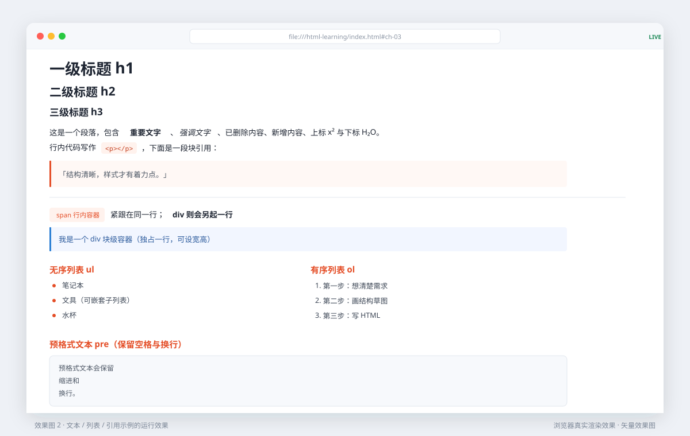
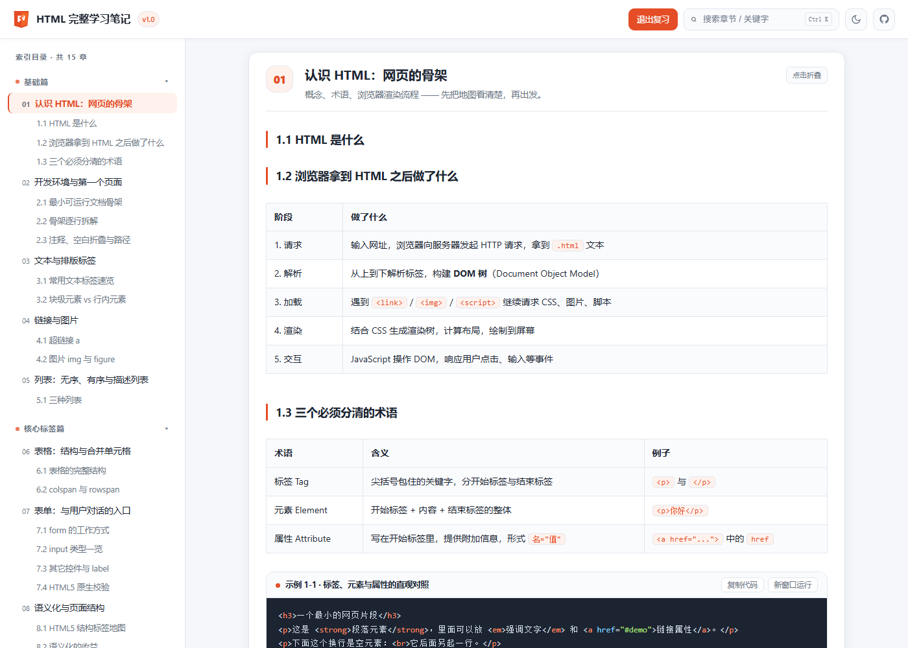

# HTML 完整学习笔记

> 一份**知识点完整、方便复习、排版清晰**的 HTML 系统笔记：16 章正文 + 一页纸速查 + 45 道自测题 + 可交互运行示例。

---

## 从哪里开始

| 我想… | 打开这个 |
| --- | --- |
| **从头系统学习** | [第 01 章 认识 HTML](docs/ch01.md) → 按章顺序读下去 |
| **一次读完整版 / 全局搜索 / 打印** | [NOTE.md 完整阅读版](NOTE.md) |
| **考前快速复习** | [CHEATSHEET.md 一页纸速查](CHEATSHEET.md) |
| **检验掌握程度** | [REVIEW.md 45 道自测题](REVIEW.md) |
| **补进阶知识点** | [第 16 章 知识补遗](docs/ch16.md) |
| **动手改代码、看运行效果** | 本地双击 [index.html](index.html)（见下方说明） |

> **重要提示**：Github 网页上点开 `.html` 文件只会显示**源代码**，不会渲染页面。
> 在 Github 上阅读请直接点上面的 **Markdown 笔记**；想体验可交互的运行效果，请把仓库下载到本地后双击 `index.html`，它是单文件、零依赖、离线可用的。

---

## 这套笔记包含什么

| 项目 | 数量 / 说明 |
| --- | --- |
| 系统章节 | **16 章**（基础篇 / 核心标签篇 / 进阶与规范篇 / 实战篇 / 知识补遗） |
| 分章文件 | 16 个 `docs/chXX.md`，每章短小独立，带章内导航、本章速览、代码示例、本节速记、复习自测 |
| 知识点 | 标签分类、内容模型、嵌套规则、全局属性、全部 input 类型、表格/表单/媒体/head、HTML5 新特性、可访问性、SEO、性能优化、废弃标签、术语表 |
| 复习资料 | 一页纸速查表 + 45 道分章自测题（点击展开答案）+ 每章「本章速览」「本节速记」 |
| 运行效果 | 4 张效果图（矢量 SVG，本页直接可见）+ 5 张真实浏览器截图（含复习模式） + HTML 交互版中 **25 个 live 实时渲染示例** |
| 排版 | 分章导航、锚点目录、对照表格、代码块、提示框、折叠答案；Markdown 版在 Github 自带大纲导航 |

---

## 完整索引目录

### 基础篇

- [01 认识 HTML：网页的骨架](docs/ch01.md) — 概念、术语、浏览器渲染流程
- [02 开发环境与第一个页面](docs/ch02.md) — DOCTYPE、文档骨架、注释、空白折叠、路径
- [03 文本与排版标签](docs/ch03.md) — 标题、段落、强调、引用、块级与行内
- [04 链接与图片](docs/ch04.md) — href 类型、锚点、alt、figure、响应式图片
- [05 列表](docs/ch05.md) — ul / ol / dl、嵌套规则、常用属性

### 核心标签篇

- [06 表格](docs/ch06.md) — 完整结构、colspan / rowspan、可访问性
- [07 表单](docs/ch07.md) — form 提交原理、input 全类型、label、原生校验
- [08 语义化与页面结构](docs/ch08.md) — HTML5 结构标签、SEO 与可访问性
- [09 多媒体与嵌入内容](docs/ch09.md) — audio / video、SVG、canvas、iframe
- [10 head 元信息与资源引入](docs/ch10.md) — meta / link / script、defer 与 async、Open Graph

### 进阶与规范篇

- [11 全局属性、字符实体与编码](docs/ch11.md) — id / class / data-*、实体、乱码排查
- [12 HTML5 新特性与相关 Web API](docs/ch12.md) — progress / meter / dialog / template / Storage
- [13 可访问性、编码规范与排错](docs/ch13.md) — a11y 清单、命名规范、常见错误
- [16 知识补遗（进阶）](docs/ch16.md) — 内容模型、废弃标签、资源提示、性能属性、iframe sandbox、表单进阶、ARIA、结构化数据、术语表

### 实战与复习篇

- [14 综合实战：一个完整的个人主页](docs/ch14.md) — 把前 13 章知识串成完整页面
- [15 速查表、自测题与后续路线](docs/ch15.md) — 标签/属性速查、12 道综合自测题、学习路线
- [CHEATSHEET.md](CHEATSHEET.md) — 一页纸速查（骨架、标签、属性、input、实体、易错点）
- [REVIEW.md](REVIEW.md) — 45 道分章自测题合集
- [NOTE.md](NOTE.md) — 完整阅读版（16 章合并，带总目录）

---

## 运行效果图

效果图为矢量 SVG，在 Github 页面上可直接显示；`assets/preview-*.png` 另有 5 张真实浏览器截图（含复习模式）。

### 效果图 1 · 笔记首页与索引目录


### 效果图 2 · 文本、列表与引用示例



### 效果图 3 · 表格与表单示例


### 效果图 4 · 综合实战个人主页


### 额外 · 复习模式（交互版真实截图）

一键收起所有章节并隐藏长讲解，只保留标题、表格、本节速记与代码示例，点章节标题即可展开复习。



---

## 三种阅读方式

| 方式 | 适合 | 怎么做 |
| --- | --- | --- |
| **分章阅读** | 第一遍学习、碎片时间 | 打开 `docs/ch01.md` 起，每章结尾有「上一章 / 下一章」导航 |
| **通读与检索** | 复习、查漏、打印 | 打开 `NOTE.md`，用浏览器 `Ctrl+F` 或 Github 右侧大纲 |
| **速查与自测** | 考前 / 面试前 | `CHEATSHEET.md` 过一遍，再用 `REVIEW.md` 默写答案 |
| **动手验证** | 理解运行效果 | 本地双击 `index.html`，每个示例有代码 + 实时渲染框，可复制、可新窗口运行 |

> 想在线访问交互版：在仓库 **Settings → Pages** 选择 `main` 分支根目录保存，之后可通过 `https://hey-yancy.github.io/html-learning/` 打开。

---

## 仓库文件结构

```
html-learning/
├── README.md                  入口与完整索引
├── NOTE.md                    完整阅读版（16 章合并）
├── CHEATSHEET.md              一页纸速查表
├── REVIEW.md                  45 道复习自测题
├── index.html                 HTML 交互版（单文件，含 25 个 live 示例）
├── docs/
│   ├── ch01.md … ch15.md      分章笔记（正文 15 章）
│   └── ch16.md                知识补遗（进阶）
├── examples/
│   └── complete-page.html     综合实战完整文档，可独立运行
└── assets/
    ├── effect-*.svg           4 张矢量运行效果图
    └── preview-*.png          5 张真实浏览器截图（含复习模式）
```

---

## 学习路线

**HTML 结构 → CSS 盒模型与 Flex / Grid → JavaScript 与 DOM → Git / 工程化 → 框架（Vue / React）→ 可访问性、性能与 SEO 进阶。**
