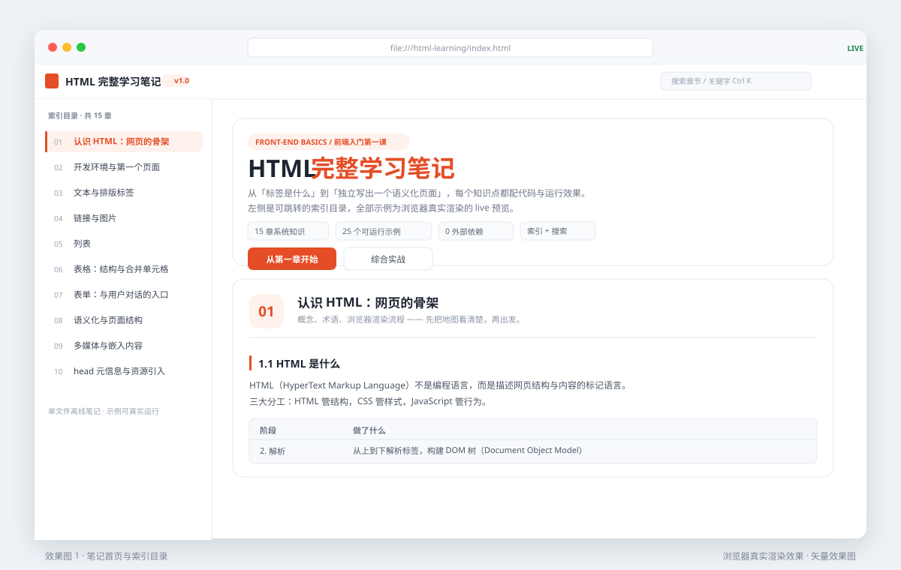

# 01 认识 HTML：网页的骨架

*概念、术语、浏览器渲染流程 —— 先把地图看清楚，再出发。*

[返回总目录](../README.md) · [下一章](ch02.md) · [HTML 交互版](../index.html#ch-01)

---

## 本章速览

本章要掌握：

- 1.1 HTML 是什么
- 1.2 浏览器拿到 HTML 之后做了什么
- 1.3 三个必须分清的术语

> 复习提示：先看章末「本节速记」与「本章复习自测」，再回看代码示例。

---

## 1.1 HTML 是什么

HTML（HyperText Markup Language，超文本标记语言）不是编程语言，而是**描述网页结构与内容的标记语言**。它用一对对标签把文字、图片、链接等包起来，告诉浏览器「这是一级标题」「那是一个按钮」。

- **超文本**：不只是文字，还能通过链接跳到另一个文档。
- **标记**：用 `<tag>` 这类标签给内容打上语义标记。
- **三大分工**：HTML 管结构，CSS 管样式，JavaScript 管行为。三者配合才有现代网页。

## 1.2 浏览器拿到 HTML 之后做了什么

| 阶段 | 做了什么 |
| --- | --- |
| 1. 请求 | 输入网址，浏览器向服务器发起 HTTP 请求，拿到 `.html` 文本 |
| 2. 解析 | 从上到下解析标签，构建 **DOM 树**（Document Object Model） |
| 3. 加载 | 遇到 `<link>` / `` / `<script>` 继续请求 CSS、图片、脚本 |
| 4. 渲染 | 结合 CSS 生成渲染树，计算布局，绘制到屏幕 |
| 5. 交互 | JavaScript 操作 DOM，响应用户点击、输入等事件 |

> **补充说明**：HTML 是**容错**的：写错标签浏览器也不会崩溃，会尽力猜测你的意图。但「能显示」不等于「写对了」——结构错误会影响 SEO、可访问性和后续维护。

## 1.3 三个必须分清的术语

| 术语 | 含义 | 例子 |
| --- | --- | --- |
| 标签 Tag | 尖括号包住的关键字，分开始标签与结束标签 | `<p>` 与 `</p>` |
| 元素 Element | 开始标签 + 内容 + 结束标签的整体 | `<p>你好</p>` |
| 属性 Attribute | 写在开始标签里，提供附加信息，形式 `名="值"` | `<a href="...">` 中的 `href` |

还有一类**空元素（void element）**没有内容和结束标签，例如 ``、`<br>`、`<input>`、`<meta>`、`<link>`、`<hr>`。HTML5 里写 `` 也可以，斜杠会被忽略。

**示例 1-1 · 标签、元素与属性的直观对照**

```html
<h3>一个最小的网页片段</h3>
<p>这是 <strong>段落元素</strong>，里面可以放 <em>强调文字</em> 和 <a href="#demo">链接属性</a>。</p>
<p>下面这个换行是空元素：<br>它后面另起一行。</p>
```

> 运行效果：打开 [HTML 交互版](../index.html#ch-01) 可查看浏览器实时渲染（可点击、可输入）。

> **本节速记**：****HTML = 结构；标签 → 元素 → 属性；空元素无结束标签；浏览器解析 HTML 生成 DOM 树再渲染。

## 本章运行效果图



## 本章复习自测

<details>
<summary>HTML 是什么？它与 CSS、JavaScript 如何分工？</summary>

HTML 是描述网页结构与内容的标记语言；HTML 管结构、CSS 管表现、JavaScript 管行为。

</details>

<details>
<summary>标签、元素、属性三者有什么区别？</summary>

标签是尖括号关键字；元素是「开始标签 + 内容 + 结束标签」整体；属性是在开始标签里补充信息的 `名="值"`。

</details>

<details>
<summary>浏览器解析 HTML 后生成什么？举出 5 个空元素。</summary>

生成 DOM 树。空元素如 `img`、`br`、`hr`、`input`、`meta`、`link`、`source`。

</details>

[查看全部章节自测题](../REVIEW.md)
