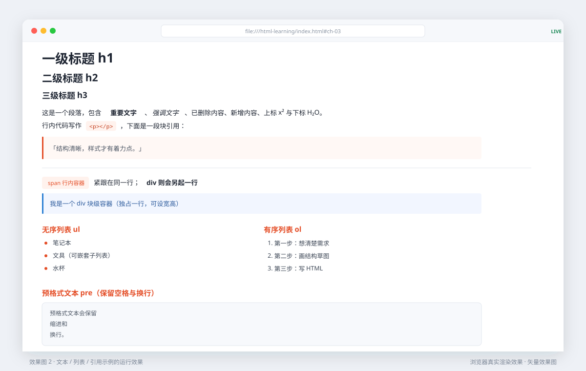

# 03 文本与排版标签

*标题、段落、强调、引用、代码，以及块级与行内的区别。*

[返回总目录](../README.md) · [上一章](ch02.md) · [下一章](ch04.md) · [HTML 交互版](../index.html#ch-03)

---

## 本章速览

本章要掌握：

- 3.1 常用文本标签速览
- 3.2 块级元素 vs 行内元素

> 复习提示：先看章末「本节速记」与「本章复习自测」，再回看代码示例。

---

## 3.1 常用文本标签速览

| 标签 | 语义 | 类型 |
| --- | --- | --- |
| `<h1> ~ <h6>` | 一到六级标题，h1 一个页面建议只用一次 | 块级 |
| `<p>` | 段落，浏览器自动在上下留间距 | 块级 |
| `<br> <hr>` | 换行 / 主题分隔线（都是空元素） | — |
| `<strong> <em>` | **重要** / *强调*，带语义，优于 b / i | 行内 |
| `<del> <ins>` | 删除线 / 下划线（表示文档修订） | 行内 |
| `<sub> <sup>` | 下标 / 上标 | 行内 |
| `<blockquote>` | 块引用，可配 `cite` 属性 | 块级 |
| `<pre> <code>` | 预格式 / 行内代码 | 块级 / 行内 |
| `<div> <span>` | 无语义容器：块级 / 行内，用于布局与样式钩子 | 块级 / 行内 |

## 3.2 块级元素 vs 行内元素

**块级元素**独占一行、可设宽高与上下外边距（如 `div`、`p`、`h1`、`ul`）；**行内元素**跟在文字流里、宽高由内容决定（如 `span`、`a`、`strong`）。还有 `img`、`input` 这类**行内块**：不换行但可设宽高。

> **常见坑**：不要为了「变大加粗」就滥用 `<h1>`，也不要用 `<br><br>` 撑间距。视觉交给 CSS，语义交给 HTML。另外 `<p>` 里不能嵌 `<div>`，浏览器会自动把段落闭合。

**示例 3-1 · 文本标签全家福（真实渲染效果）**

```html
<h1>一级标题 h1</h1>
<h2>二级标题 h2</h2>
<h3>三级标题 h3</h3>
<p>这是一个段落，包含 <strong>重要文字</strong>、<em>强调文字</em>、
<del>已删除内容</del>、<ins>新增内容</ins>、上标 x<sup>2</sup> 与下标 H<sub>2</sub>O。</p>
<p>行内代码写作 <code>&lt;p&gt;&lt;/p&gt;</code>，下面是一段块引用：</p>
<blockquote cite="https://example.com">「结构清晰，样式才有着力点。」</blockquote>
<hr>
<p><span style="background:#fff2ed;color:#e44d26;padding:2px 6px;border-radius:4px">span 行内容器</span>
紧跟在同一行；<strong>div 则会另起一行</strong>。</p>
<div style="background:#f2f6ff;border-left:3px solid #2b7fd4;padding:8px 12px">我是一个 div 块级容器</div>
```

> 运行效果：打开 [HTML 交互版](../index.html#ch-03) 可查看浏览器实时渲染（可点击、可输入）。

> **本节速记**：****标题有层级、段落成块；强调优先 strong / em；样式用 CSS，结构用语义标签；块级换行、行内随文。

## 本章运行效果图



## 本章复习自测

<details>
<summary>块级、行内、行内块元素有什么区别？各举两例。</summary>

块级独占一行可设宽高（div、p、h1、ul）；行内随文字流、宽高由内容决定（span、a、strong）；行内块不换行但可设宽高（img、input）。

</details>

<details>
<summary>`strong` 与 `b`、`em` 与 `i` 该优先用哪个？</summary>

优先 `strong` / `em`，它们带「重要 / 强调」语义，利于屏幕阅读器与 SEO；b / i 只描述外观。

</details>

<details>
<summary>为什么 `<p>` 里不能嵌 `<div>`？连续空格如何保留？</summary>

浏览器遇到块级元素会自动闭合段落，导致结构错乱。保留空白用 `<pre>` 或 CSS `white-space`，也可用 `&nbsp;`。

</details>

[查看全部章节自测题](../REVIEW.md)
