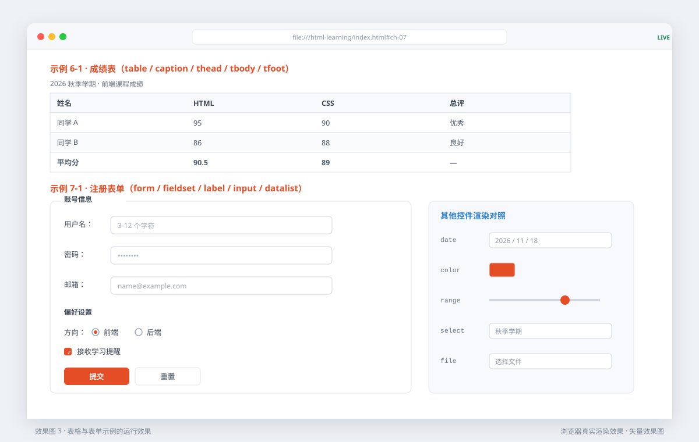

# 07 表单：与用户对话的入口

*form、input 全类型、label、校验属性与提交原理。*

[返回总目录](../README.md) · [上一章](ch06.md) · [下一章](ch08.md) · [HTML 交互版](../index.html#ch-07)

---

## 本章速览

本章要掌握：

- 7.1 form 的工作方式
- 7.2 input 类型一览
- 7.3 其它控件与 label
- 7.4 HTML5 原生校验

> 复习提示：先看章末「本节速记」与「本章复习自测」，再回看代码示例。

---

## 7.1 form 的工作方式

用户填写控件 → 点击提交 → 浏览器把带 `name` 的控件按 `name=value` 打包 → 按 `method` 发送到 `action` 指定的地址。**没有 name 的控件不会被提交。**

| 属性 | 说明 |
| --- | --- |
| `action` | 接收数据的 URL，留空表示提交到当前页 |
| `method="get"` | 数据拼在 URL 查询串里，适合搜索、筛选（不适合密码） |
| `method="post"` | 数据放在请求体里，适合登录、写入操作 |
| `enctype` | 上传文件必须设为 `multipart/form-data` |
| `autocomplete / novalidate` | 自动填充 / 关闭原生校验 |

## 7.2 input 类型一览

| type | 用途 | type | 用途 |
| --- | --- | --- | --- |
| `text` | 单行文本（默认值） | `password` | 密码，输入被遮蔽 |
| `email / url / tel` | 带格式校验与移动端键盘优化 | `number` | 数字，配 min / max / step |
| `radio` | 单选，同组 name 必须相同 | `checkbox` | 多选，name 常用数组形式 |
| `date / time / datetime-local` | 原生日期时间选择器 | `month / week` | 月 / 周选择 |
| `range` | 滑块 | `color` | 取色器 |
| `file` | 文件上传，配 `multiple` / `accept` | `hidden` | 隐藏字段 |
| `search` | 搜索框 | `submit / reset / button` | 提交 / 重置 / 普通按钮 |

## 7.3 其它控件与 label

`<label>` 有两种关联写法：用 `for` 指向控件的 `id`，或直接把控件包在 label 里。关联后点击文字也能聚焦/勾选控件，对可访问性很关键。

- `<textarea rows cols>`：多行文本；`<select> + <option> + <optgroup>`：下拉选择
- `<fieldset> + <legend>`：给一组控件加分组标题
- `<datalist> + list`：给输入框提供候选建议（仍可自由输入）
- `<button type="submit|reset|button">`：比 input 按钮更灵活，可放图标

## 7.4 HTML5 原生校验

| 属性 | 作用 |
| --- | --- |
| `required` | 必填 |
| `placeholder` | 占位提示（不能替代 label） |
| `pattern` | 正则校验，如 `pattern="[0-9]{11}"` |
| `min / max / minlength / maxlength` | 数值或长度范围 |
| `checked / selected / disabled / readonly` | 布尔属性：写上即生效 |
| `autofocus / autocomplete` | 自动聚焦 / 自动填充策略 |

**示例 7-1 · 一个可直接交互的注册表单**

```html
<form action="#" method="post" onsubmit="alert('演示：这里不会真的提交');return false">
  <fieldset>
    <legend>账号信息</legend>
    <p><label for="u">用户名：</label>
       <input id="u" name="username" type="text" placeholder="3-12 个字符" required minlength="3" maxlength="12"></p>
    <p><label for="p">密码：</label>
       <input id="p" name="password" type="password" required minlength="6"></p>
    <p><label for="e">邮箱：</label>
       <input id="e" name="email" type="email" placeholder="name@example.com" required></p>
  </fieldset>
  <fieldset>
    <legend>偏好设置</legend>
    <p>方向：
      <label><input type="radio" name="track" value="fe" checked> 前端</label>
      <label><input type="radio" name="track" value="be"> 后端</label></p>
    <p><label><input type="checkbox" name="subscribe" checked> 接收学习提醒</label></p>
    <p><label for="lv">掌握程度：</label>
       <input id="lv" name="level" type="range" min="0" max="100" value="60"></p>
    <p><label for="city">常用编辑器：</label>
       <input id="city" name="editor" list="editors" placeholder="可输入或选择">
       <datalist id="editors"><option value="VS Code"><option value="WebStorm"><option value="Sublime Text"></datalist></p>
    <p><label for="bio">自我介绍：</label><br>
       <textarea id="bio" name="bio" rows="2" cols="34" placeholder="一句话介绍自己"></textarea></p>
  </fieldset>
  <button type="submit">提交</button> <button type="reset">重置</button>
</form>
```

> 运行效果：打开 [HTML 交互版](../index.html#ch-07) 可查看浏览器实时渲染（可点击、可输入）。

**示例 7-2 · 各类 input 与 select 的渲染对照**

```html
<p>日期：<input type="date">　颜色：<input type="color" value="#e44d26">　数字：<input type="number" min="1" max="9" value="3" style="width:70px"></p>
<p>文件：<input type="file">　滑块：<input type="range" min="0" max="10" value="7"></p>
<p>下拉：
<select name="term">
  <optgroup label="2026 年"><option>春季学期</option><option selected>秋季学期</option></optgroup>
  <optgroup label="2027 年"><option>春季学期</option></optgroup>
</select></p>
<p>禁用：<input type="text" value="不可编辑" disabled>　只读：<input type="text" value="可复制不可改" readonly></p>
```

> **提示**：原生校验只是**用户体验层**，服务端必须重新校验所有数据。布尔属性写成 `required="false"` 依然是「必填」——只要属性存在就生效。

> **本节速记**：****name 决定提交什么，method 决定怎么发；label 必配；select / textarea / fieldset 各司其职；原生校验不能替代服务端校验。

## 本章运行效果图



## 本章复习自测

<details>
<summary>GET 与 POST 该怎么选？</summary>

GET 把数据拼在 URL 上，适合搜索 / 筛选等无副作用请求；POST 放请求体，适合登录、写入、上传。

</details>

<details>
<summary>某个输入框的值没被提交，最可能是什么原因？</summary>

控件缺少 `name`，或被 `disabled` 禁用；只有带 name 且启用的控件才会被序列化。

</details>

<details>
<summary>`label` 有哪两种关联方式？`disabled` 与 `readonly` 有何不同？</summary>

`for` 指向控件 id，或把控件直接包进 label；disabled 不聚焦、不提交，readonly 可聚焦、可复制、仍会提交。

</details>

[查看全部章节自测题](../REVIEW.md)
