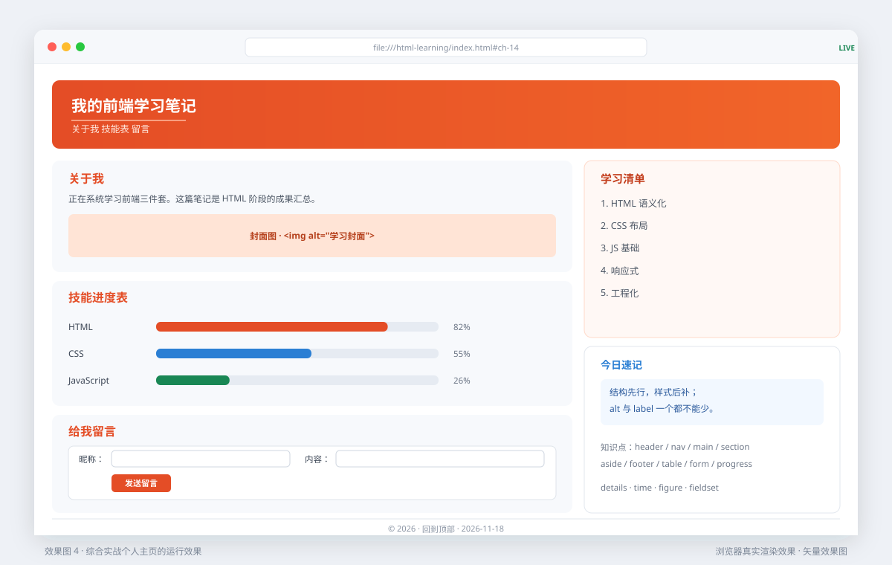

# 14 综合实战：一个完整的个人主页

*把前 13 章的知识串起来：语义结构、列表、表格、表单、figure、锚点一次用齐。*

[返回总目录](../README.md) · [上一章](ch13.md) · [下一章](ch15.md) · [HTML 交互版](../index.html#ch-14)

---

## 本章速览

本章要掌握：

- 14.1 先规划结构，再写代码
- 14.2 完整示例（下方是真实运行效果）
- 14.3 这个页面用到了哪些知识点

> 复习提示：先看章末「本节速记」与「本章复习自测」，再回看代码示例。

---

## 14.1 先规划结构，再写代码

动手前先画草图：`header`（站点名 + `nav` 锚点导航）→ `main` 里三个 `section`（关于我 / 技能表格 / 留言表单）→ 侧边 `aside`（学习清单）→ `footer`。结构清楚了，HTML 基本就是「照着填」。

## 14.2 完整示例（下方是真实运行效果）

**示例 14-1 · 综合实战：个人主页（可直接点击交互）**

```html
<header style="background:linear-gradient(120deg,#e44d26,#f16529);color:#fff;border-radius:10px;padding:16px 20px">
  <h1 style="margin:0;font-size:22px">我的前端学习笔记</h1>
  <nav style="margin-top:8px;font-size:13px">
    <a href="#about" style="color:#fff;margin-right:14px">关于我</a>
    <a href="#skill" style="color:#fff;margin-right:14px">技能表</a>
    <a href="#msg" style="color:#fff">留言</a>
  </nav>
</header>
<div style="display:flex;gap:14px;margin-top:12px;flex-wrap:wrap">
  <main style="flex:3;min-width:260px">
    <section id="about" style="background:#f7f9fc;border-radius:10px;padding:14px 18px;margin-bottom:12px">
      <h2 style="margin:0 0 8px;font-size:18px;color:#e44d26">关于我</h2>
      <p style="margin:4px 0">正在系统学习前端三件套。这篇笔记是 HTML 阶段的成果汇总。</p>
      <figure style="margin:10px 0 0;text-align:center">
        <div style="height:70px;line-height:70px;background:linear-gradient(120deg,#ffe4d6,#ffd0bb);border-radius:8px;color:#b5401c;font-weight:700">封面图 · &lt;img alt="学习封面"&gt;</div>
        <figcaption style="font-size:12px;color:#6c7686">图 14-1：figure + figcaption</figcaption>
      </figure>
    </section>
    <section id="skill" style="background:#f7f9fc;border-radius:10px;padding:14px 18px;margin-bottom:12px">
      <h2 style="margin:0 0 8px;font-size:18px;color:#e44d26">技能进度表</h2>
      <table>
        <caption style="font-size:12px;color:#6c7686">2026 秋季学期自评</caption>
        <tr><th>技能</th><th>掌握度</th><th>状态</th></tr>
        <tr><td>HTML</td><td><progress value="80" max="100"></progress></td><td>熟练</td></tr>
        <tr><td>CSS</td><td><progress value="55" max="100"></progress></td><td>学习中</td></tr>
        <tr><td>JavaScript</td><td><progress value="25" max="100"></progress></td><td>入门</td></tr>
      </table>
    </section>
    <section id="msg" style="background:#f7f9fc;border-radius:10px;padding:14px 18px">
      <h2 style="margin:0 0 8px;font-size:18px;color:#e44d26">给我留言</h2>
      <form action="#" method="post" onsubmit="alert('演示表单：不会真的提交');return false">
        <fieldset style="border:1px solid #dfe4ea;border-radius:8px">
          <legend style="font-size:13px">留言信息</legend>
          <p><label for="n">昵称：</label><input id="n" name="nick" required placeholder="怎么称呼你"></p>
          <p><label for="m">内容：</label><br><textarea id="m" name="msg" rows="2" cols="30" required></textarea></p>
          <p><label><input type="checkbox" name="agree" checked> 同意展示在页面上</label></p>
          <button type="submit">发送留言</button>
        </fieldset>
      </form>
    </section>
  </main>
  <aside style="flex:1;min-width:180px;background:#fff8f5;border:1px solid #ffd9c9;border-radius:10px;padding:14px 18px;align-self:flex-start">
    <h3 style="margin:0 0 8px;font-size:15px;color:#c33d1c">学习清单</h3>
    <ol style="padding-left:18px;margin:0"><li>HTML 语义化</li><li>CSS 布局</li><li>JS 基础</li><li>响应式</li><li>工程化</li></ol>
    <details style="margin-top:10px"><summary style="font-size:13px">今日速记</summary>
      <p style="font-size:12px;color:#555">结构先行，样式后补；alt 与 label 一个都不能少。</p></details>
  </aside>
</div>
<footer style="text-align:center;color:#6c7686;font-size:12px;margin-top:14px;padding:10px;border-top:1px solid #e2e7ee">
  © 2026 · <a href="#top">回到顶部</a> · <time datetime="2026-11-18">2026-11-18</time>
</footer>
```

> 运行效果：打开 [HTML 交互版](../index.html#ch-14) 可查看浏览器实时渲染（可点击、可输入）。

> **配套文件**：仓库中的 `examples/complete-page.html` 是这份示例的**完整文档版本**（含 DOCTYPE、head、body），可以直接双击在浏览器打开或作为新项目的起点。

## 14.3 这个页面用到了哪些知识点

| 章节 | 在实战中的落点 |
| --- | --- |
| 02 文档骨架 | 完整的 head + body 组织（见配套文件） |
| 04 链接与图片 | nav 锚点导航、figure / figcaption、外链 |
| 05 / 06 列表表格 | aside 有序清单、技能进度表格 |
| 07 表单 | label、fieldset / legend、required、textarea、checkbox |
| 08 语义化 | header / nav / main / section / aside / footer / time |
| 12 HTML5 | progress、details / summary |
| 13 可访问性 | label 关联、表单 name、语义层级、alt |

> **本节速记**：****先画结构草图 → 用语义标签搭骨架 → 逐个区块填内容 → 最后用 CSS 美化；HTML 阶段不追求好看，追求「结构正确」。

## 本章运行效果图



## 本章复习自测

<details>
<summary>动手写页面前应该先做什么？</summary>

先画结构草图，确定 header / nav / main / section / aside / footer 的分区，再用语义标签搭骨架，最后填内容与补样式。

</details>

<details>
<summary>综合示例里用到了哪些表单与 HTML5 元素？</summary>

form / fieldset / legend / label / input / textarea / checkbox / required，以及 progress、details / summary、time、figure。

</details>

<details>
<summary>HTML 阶段最应该追求什么？</summary>

结构正确、语义清晰、可访问，而不是视觉好看；视觉交给 CSS，行为交给 JavaScript。

</details>

[查看全部章节自测题](../REVIEW.md)
